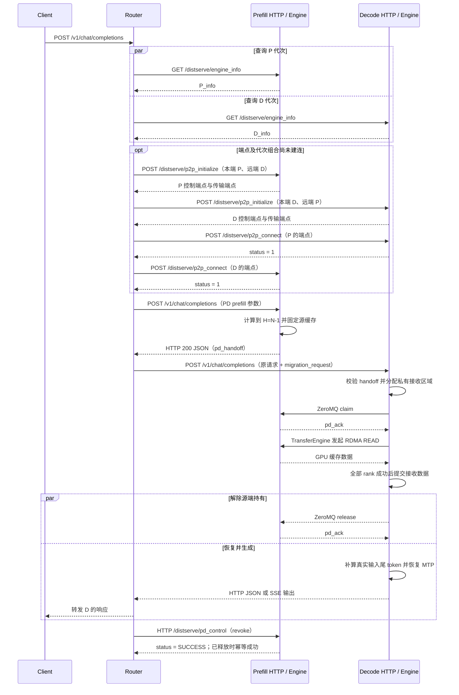

# GLM-5.3-Flash 的 PD 分离与 Mooncake Store 协同设计

技术报告 · 2026-11-18

代码范围：LMDeploy `feat/optimize_pd_disaggregation`（`9aac56be`）与 lmdeploy-router `feat/support_lmdeploy_pd`（`5cc52026`）。本文基于两个分支的实现与已归档实验，介绍系统设计、功能完善、性能优化及验证结果。

## 摘要

本工作在 LMDeploy 中实现了 GLM-5.3-Flash 的 Prefill/Decode 分离，并使 Mooncake PD 迁移后端与 Mooncake Store 同时工作。方案以统一的输入边界交接主模型 KV、MTP 缓存及混合注意力状态；Decode 恢复生成后，将新增缓存保存至 Store，供后续请求复用。工程实现进一步完善了路由、缓存引用保护、取消与超时回收，并通过短输入 CUDA Graph、传输区间合并和请求准备优化降低交接开销。

在 8×H200、充分预热的指定多轮负载中，PD 平均首 token 延迟由 919.34 ms 降至 681.29 ms，降低 25.9%；输出吞吐提高 6.3%。同卡数非 PD 在该热缓存、低并发负载下仍具有更低延迟和更高吞吐。完整 GSM8K 验证中，PD 与直接推理分别为 97.57% 和 97.19%；部分短边界输入的逐 token 差异尚未解决。Mooncake 0.3.14 的主要收益是失败状态与资源生命周期处理，最终端到端性能对照基本持平。

## 1. 背景与设计目标

大模型推理包含两个执行阶段。Prefill（P）读取输入并构建历史缓存，计算量随输入长度增长；Decode（D）利用已有缓存逐步生成答案。PD 分离将两个阶段部署到不同的 GPU 资源组，为独立扩缩容和减少长输入对生成阶段的干扰提供基础。它同时引入跨节点缓存交接，因此收益取决于输入长度、缓存命中率、并发和 P:D 资源比例。

Mooncake 在本方案中承担两种职责：PD 迁移后端通过 TransferEngine 将当前请求所需的数据从 P 交给 D；Mooncake Store 保存可复用的历史缓存，减少后续请求的重复计算。前者服务于一次请求内部的阶段切换，后者服务于跨请求、跨轮次的复用。

GLM-5.3-Flash 的恢复数据分为四类：主模型分页缓存、MTP 分页缓存、KDA 状态和 KPool 尾部状态。前两类保存主模型与多 token 预测（MTP）模块的注意力历史；后两类保存主模型线性注意力的卷积与递推状态，以及 KPool 尚未组成完整分组的尾部数据。设计的核心约束是：这些数据必须对应同一有效输入边界；传输、Store 保存和本地请求对缓存的持有关系必须独立；尚未完成的传输不能提前发布为可共享缓存。

## 2. 系统架构与协同缓存

### 2.1 组件职责与数据路径

系统由 Router、P 资源组、D 资源组和共享 Mooncake Store 构成，如图 1 所示。Router 选择实际 P/D HTTP 端点，并转交请求、token IDs 和交接描述符（handoff）。大块 KV/state 数据由 D 发起 RDMA READ，直接从 P 的已注册 GPU 缓存读取，不经过 Router。图中的 Store 表示逻辑上的缓存存储，其数据路径不要求经由 Store master 中转。


图 1. GLM-5.3-Flash 的协同缓存架构。两端 GPU 缓存池均包含主模型分页缓存、MTP 分页缓存、KDA 状态和 KPool 尾部状态；箭头标注交接边界 H=N−1，该边界的 KDA 状态记为 S_H。蓝色表示分页缓存及 PD 数据路径，橙色表示 KDA/KPool 状态或受保护资源，紫色表示 Store 及其数据路径。每个 worker 内的 PD 连接共享一个 PD TransferEngine，Store 保留独立的传输实例与注册生命周期。[矢量图](assets/mooncake_pd_glm53_flash/figure_1_architecture.svg)

四类缓存的内容与管理单位如下：

| 名称 | 保存的内容 | 管理单位 |
| --- | --- | --- |
| 主模型分页缓存 | 主模型 full attention 侧的分页数据，包括 MLA KV、KPool 索引缓存等 | 主模型 KV block |
| MTP 分页缓存 | MTP 预测器自己的 KV、KPool 索引缓存，以及用于重建尾部的原始 key/score token cache | MTP block |
| KDA 状态 | 主模型 KDA 线性注意力的卷积历史状态与 recurrent state（递推状态） | compact state unit |
| KPool 尾部状态（AUX） | 主模型 KPool 的原始 key/score 环形缓存，用于未完成分组的尾部恢复及推测执行回退 | 请求私有 auxiliary slot |

KDA 状态和 KPool 尾部状态属于主模型。当前 MTP 模块不包含 KDA，其 KPool 尾部从自身分页 token cache 重建，因此纳入 MTP 分页缓存。四类资源分别按 block、state unit 或请求 slot 管理，并非全部使用 KV block ID。[资源分组实现](../lmdeploy/pytorch/disagg/runtime.py)

P 从 Store 恢复可复用前缀，完成剩余输入计算，并向 D 提供当前请求的恢复数据。D 复用本地已有的完整 KV 前缀，接收缺失数据，随后生成答案；生成阶段的新缓存按检查点策略写回 Store。两条 Mooncake 路径访问同一批 GPU 缓存，但分别持有引用：PD 完成只能解除 PD 的持有，尚未结束的 Store 保存继续保护对应缓存。

两个功能沿用各自的配置入口，无需引入 MultiConnector。表 1 给出同时启用时的关键角色设置；完整启动入口见[模型脚本](../benchmark/mooncake_pd_glm.sh)和 [Router 脚本](../benchmark/mooncake_pd_router.sh)。

表 1. P/D 与 Store 的职责配置。

| 配置            | P 节点                           | D 节点              |
| --------------- | -------------------------------- | ------------------- |
| 推理角色        | `--role Prefill`                 | `--role Decode`     |
| PD 后端         | `--migration-backend Mooncake`   | 同左                |
| Store connector | `MooncakeStoreConnector`         | 同左                |
| Store 角色      | `kv_both`：读取并保存            | `kv_producer`：保存 |
| 本地前缀缓存    | `--enable-prefix-caching`        | 同左                |
| MTP             | `deepseek_mtp`，draft tokens = 5 | 相同配置            |

Store 通过 `--kv-transfer-config` 配置。D 额外启用 `--prefix-cache-decode-save-first --prefix-cache-decode-state-interval 1024`，在首次满足保存条件时建立检查点，并按 1024-token 间隔保存后续状态。实际部署还需提供 Store 配置文件、RDMA 环境，以及相容的模型、MTP 和 attention TP 配置。

### 2.2 精确状态交接与 MTP 恢复

本方案采用“由 D 补算最后一个真实输入 token”的恢复方式。设完整输入长度为 N，交接边界为 H=N−1，S_H 表示主模型处理完前 H 个输入 token 后的 KDA 状态，即该边界的卷积历史与递推状态；它不是输出 hidden states，也不是缓存池的类别名。P 的主模型计算停在 H，并准备主模型分页缓存、MTP 分页缓存、S_H 以及同一边界的 KPool 尾部状态；D 从该边界处理最后一个真实输入 token，生成首个输出 token，并建立本地 MTP 草稿。

例如 N=8192 时，H=8191。当前 KPool 每 4 个 token 组成一组，此时尾部还有 3 个 token 未组成完整分组，D 需要其原始 key/score 才能在处理下一 token 时继续完成分组。Store 在 64-token 对齐边界恢复时，这类未完成尾部为空，可以不持久化；PD 交接边界可能不对齐，因此需要传输 KPool 尾部状态。[状态声明](../lmdeploy/pytorch/configurations/glm5_next.py)

这一方式使 D 继续沿用正常的采样、停止条件和 MTP 验证流程。P 不向 D 交接已经采样的输出 token 或草稿，避免两端各自生成造成计数、状态和停止条件不一致。具体流程如图 2 所示。


图 2. 输入边界 H=N−1 上的交接流程。P 在发布描述符前固定源端缓存；D 校验并领取读取许可（claim），完成 RDMA 读取后恢复生成。全部参与 rank 完成接收后才提交缓存，源端释放通知（release）异步发送。[矢量图](assets/mooncake_pd_glm53_flash/figure_2_handoff.svg)

描述符包含请求身份、有效输入边界、缓存布局及引擎代次等信息。D 校验模型、MTP、数据类型、block 大小及 attention TP 等执行语义；完整且只读的本地 KV 前缀可以复用，缺失部分及尾部数据写入当前请求的私有接收区域。精确 KDA 状态仍按 H 恢复，不能用较早的状态快照代替。

接收结果在所有参与 rank 成功后统一提交。这里的 rank 指参与执行的工作进程，KV block 指缓存分配单元；本次 GLM 配置每个 block 对应 64 tokens。该提交边界防止其他请求看到半完成数据，也避免 RDMA 覆盖正在共享的前缀缓存。

### 2.3 Decode 检查点与跨轮次复用

Decode 保存使 Store 能够覆盖模型新生成的内容。图 3 展示了一次实测：首轮输入 8192 tokens、输出 1088 tokens，D 分别在 8192 和 9216 边界保存检查点；后者包含新增的 16 个 KV block。下一轮由实际输出 IDs 和 8 个新输入 tokens 组成，总长 9288，P 从 Store 恢复到 9216，仅需补算 71 tokens，再由 D 补算最后 1 token。


图 3. Decode 生成内容进入 Store 后的跨轮次复用。橙色检查点将精确状态与对应 KV 前缀关联；长度示意未按比例绘制。[矢量图](assets/mooncake_pd_glm53_flash/figure_3_store_reuse.svg)

最终复测中，P 加载到与 D 保存时相同的状态 hash，Store native load 约为 9.03 ms。该结果验证了生成阶段新增缓存的实际复用，而不仅是原始 prompt 的保存与恢复。[实测记录](mooncake_0314_pd_upgrade.md)

### 2.4 Router 与 Prefill/Decode worker 的交互协议

本节按一次 `POST /v1/chat/completions` 请求的生命周期说明 Mooncake v2 协议。P/D worker 指 Router 注册的实际 HTTP 服务端点；一个端点背后可以有多个 GPU 执行 rank。DP 部署应注册每个实际 HTTP 端口，例如 P 的 `http://prefill:20500` 和 D 的 `http://decode:20700`，不能用 `@rank` 虚拟地址代替。

阅读顺序是：先看连接握手如何交换端点，再看 P 如何发布 handoff、D 如何读取，最后看控制消息与收尾。协议有三条相互独立的链路：

| 链路 | 发起方与接收方 | 载荷 | 这条链路的完成含义 |
| --- | --- | --- | --- |
| HTTP 编排 | Client → Router → P/D | OpenAI 请求、连接管理接口、handoff；请求收尾时 Router 发 HTTP `revoke` | 只代表当前 HTTP 操作已处理，不代表 RDMA 已排空 |
| P/D 控制 | D → P 的 `claim/release/revoke`；P → D 的 `abort` | ZeroMQ JSON 控制消息及 `pd_ack` | ACK 表示对端已接受控制操作，不证明 GPU 数据传输完成 |
| 缓存传输 | D 的 TransferEngine 读取 P 的 GPU 缓存 | RDMA READ，第 2.1 节的四类缓存 | 所有参与 rank 的传输结果决定 D 能否提交接收数据 |

**交互时序。** 连接握手先于 P 导出缓存。正常路径中，D 传输完成后异步释放 P 的缓存持有，同时恢复输入尾部并生成；Router 在 HTTP 请求结束时再做幂等收尾。图中省略 Store 读写，其引用独立管理。



#### 2.4.1 发现端点与建立连接

Router 每次处理 PD 请求时并发查询 P、D 的 `GET /distserve/engine_info`，请求无 body。下例展示配置字段；容量与 epoch 均为运行时值：

```json
{
  "tp_size": 1,
  "ep_size": 4,
  "dp_size": 4,
  "pp_size": null,
  "dp_rank": 0,
  "block_size": 64,
  "num_cpu_blocks": 0,
  "num_gpu_blocks": 4096,
  "engine_epoch": "p-epoch",
  "protocol_version": 2
}
```

| 字段 | 作用 |
| --- | --- |
| `tp_size`、`ep_size`、`dp_size`、`pp_size`、`dp_rank` | 执行拓扑；`tp_size` 是 attention TP，当前 Router 要求 P/D 相同 |
| `block_size`、`num_cpu_blocks`、`num_gpu_blocks` | 缓存块大小与容量；worker 用配置计算并校验缓存布局 |
| `engine_epoch` | worker 实例代次；重启或 sleep/wakeup 后变化，用于隔离旧连接和旧控制消息 |
| `protocol_version` | PD 协议能力版本；Router 要求两端为 2 |

Router 将 `P_info`、`D_info` 分别完整传给两端的初始化接口；Router 自身只读取协议版本、epoch 和 attention TP。

**初始化。** `POST /distserve/p2p_initialize` 分别调用 P 和 D，第二次调用时 local/remote 角色对调：

| Request 字段 | 作用 |
| --- | --- |
| `local_engine_id` / `remote_engine_id` | 本端/对端实际 HTTP URL，也是连接表中的 peer identity |
| `local_engine_config` / `remote_engine_config` | 对应的完整 `engine_info`，供 worker 初始化传输后端和校验布局 |
| `protocol` | 传输类型枚举；RDMA 的 wire value 为 2 |
| `rdma_config` | RDMA 参数：`with_gdr` 控制 GDR，`link_type` 为 1（IB）或 2（RoCE） |
| `nvlink_config`、`tcp_config` | 其他传输配置；当前 RDMA 请求中 `nvlink_config=null`，Router 不发送 `tcp_config` |
| `rank` | 可选的 rank 局部字段；Router 不填写，worker 在 rank 级初始化时补入 |

初始化 response 包含 `status`、`engine_endpoint_info` 和 `kvtransfer_endpoint_info`。`status=1` 表示成功，`status=2` 表示失败；Router 同时检查 HTTP 状态码与 JSON body。

**连接。** `POST /distserve/p2p_connect` 将初始化响应中的远端端点传给另一端：

| Request 字段 | 作用 |
| --- | --- |
| `protocol` | 建立哪种传输连接 |
| `remote_engine_id` | 对端 HTTP URL，用于定位 peer |
| `remote_engine_endpoint_info` | 对端控制端点信息 |
| `remote_kvtransfer_endpoint_info` | 对端各执行 rank 的缓存传输端点列表 |

成功 response 为 `{"status":1}`。两端都初始化并互换端点后才可处理 handoff。

初始化响应中的端点对象如下：

| 字段 | 作用 |
| --- | --- |
| `engine_endpoint_info.zmq_address` | 例如 `tcp://prefill:31001`，供 P/D 发送控制消息 |
| `kvtransfer_endpoint_info[]` | 各执行 rank 的缓存传输端点；worker 按本地 TP rank 取对应项，Router 原样转交，不能仅凭 attention TP 推断数组布局 |
| 列表项 `protocol`、`version` | 传输类型与端点描述版本；Mooncake v2 端点为 2 |
| 列表项 `cache_schema` | 模型、MTP、dtype、缓存布局和 attention TP 等执行语义指纹 |
| 列表项 `cache_pools[]` | 每个已注册缓存池的 `group/shape/dtype/element_size/entry_axis`；`group` 标识 `target/draft/state/auxiliary/legacy_state` 资源 |
| 列表项 `endpoint_info` | 当前是 **JSON 编码的字符串**。Mooncake 解码后包含传输 `session_id`（`host:port`）和 `mr_info`（注册内存区域的 `addr/length/offset`） |

Router 不解析 GPU 地址，也不计算迁移区间。这里 Mooncake 的 `session_id` 是传输服务地址；handoff 中的整数 `session_id` 是 P 推理会话编号，二者不是同一字段语义。

连接缓存按 `(P URL, D URL, P epoch, D epoch)` 区分。同一端点与代次组合的并发请求共用一次初始化；后续请求仍查询 `engine_info`，但成功的 initialize/connect 会复用。epoch 改变或连接失败后重新握手。

#### 2.4.2 请求转交与 handoff 字段

**Router → P。** Router 基于用户请求构造 P 请求，并设置 PD 前缀导出参数：

| 字段 | 作用 |
| --- | --- |
| `pd_prefill=true` | 让 P 执行前缀计算并发布 handoff |
| `with_cache=true`、`preserve_cache=true` | 保留可迁移的源缓存，直到收到 release/revoke 或租约回收 |
| `stream=false` | 要求 P 返回包含 handoff 的 JSON，而非 SSE |
| `max_tokens=1` | 满足模型接口的生成参数校验；`pd_prefill` 路径不在 P 采样答案 token |
| `max_completion_tokens`、`min_new_tokens` | 若存在，分别将最大输出和大于 1 的最小输出限制为 1 |
| `stream_options`、客户端 `migration_request` | 从 P 请求移除；前者只适用于流式输出，后者属于 Router 生成的控制数据 |

示例假设输入为 5 个 token、用户设置 `max_tokens=128` 且 `stream=true`：

```json
{
  "model": "glm-5.3-flash",
  "messages": [],
  "input_ids": [100, 101, 102, 103, 104],
  "max_tokens": 1,
  "stream": false,
  "pd_prefill": true,
  "with_cache": true,
  "preserve_cache": true
}
```

P 处理前 4 个 token，在 `H=N-1` 边界固定缓存并返回 `pd_handoff`。下例只展示 PD 字段；真实 OpenAI response 还包含 `id/model/choices/usage`。示例中的 ID、epoch、schema 和 digest 均为占位值：

```json
{
  "pd_handoff": {
    "version": 2,
    "transfer_id": "transfer-001",
    "engine_epoch": "p-epoch",
    "session_id": 42,
    "cache_schema": "schema-hash",
    "prompt_digest": "prompt-hash",
    "prompt_token_count": 5,
    "valid_token_count": 4,
    "prefill_cached_tokens": 0,
    "block_size": 64,
    "block_ids": [17],
    "state_ids": [11],
    "auxiliary_id": 4,
    "legacy_state_id": null
  }
}
```

| `pd_handoff` 字段 | D 或 Router 如何使用 |
| --- | --- |
| `version` | handoff 对象格式版本；当前为 2，不等同于 `engine_info.protocol_version` 或传输端点 `version` |
| `transfer_id` | 唯一标识一次源缓存导出；claim、release、revoke、abort 都以它定位资源 |
| `engine_epoch` | 源 P 的实例代次，防止旧 handoff/控制消息作用于重启后的 worker |
| `session_id` | P 的推理会话编号；用于兼容会话生命周期接口，不从 OpenAI response `id` 推导 |
| `cache_schema` | 校验模型、MTP、dtype、block 布局和 attention TP 等执行语义 |
| `prompt_digest`、`prompt_token_count` | 校验 D 的完整输入与该缓存属于同一个 prompt；token 数不能替代内容摘要 |
| `valid_token_count` | 已导出的有效前缀长度 H；D 从 H 继续处理剩余输入，本例为 4 |
| `prefill_cached_tokens` | P 侧前缀缓存命中数，用于统计，不计入本次 PD 传输命中 |
| `block_size`、`block_ids` | 主模型/MTP 源 block 布局及资源索引；D 根据它们计算需要读取的 block |
| `state_ids` | 各 attention rank 的 compact KDA state ID |
| `auxiliary_id` | 源请求的 KPool 尾部 slot ID |
| `legacy_state_id` | 旧式 state 存储兼容 slot；当前示例为空 |

`block_ids/state_ids/auxiliary_id` 是源资源索引，目标地址结合握手时交换的池布局计算。v2 的权威交接描述是 `pd_handoff`；response 顶层的 `cache_block_ids/remote_token_ids` 是旧接口字段，不应作为 v2 handoff 的替代来源。

对于通常使用 `messages` 的纯文本 chat 请求，Router 可设置 `return_token_ids=true`，让 P 返回完整 N 个 `prompt_token_ids` 供 D 免去重复分词。需要 `return_prompt_text` 或包含多模态输入时不走该优化。若请求已经用 `input_ids` 提供完整输入，则无需再传 prompt IDs。

**Router → D。** Router 从原始用户请求构造 D 请求，清除 P 专用的 `pd_prefill/with_cache/preserve_cache` 和客户端传入的 `migration_request`，再加入以下迁移对象：

| `migration_request` 字段 | 作用 |
| --- | --- |
| `protocol` | 传输类型；当前 RDMA wire value 为 2 |
| `remote_engine_id` | 源 P 的 HTTP URL，用于选择已建立的 P/D 连接 |
| `remote_session_id` | 兼容旧迁移接口的源会话号；当前 v2 值等于 `handoff.session_id` |
| `handoff` | 上表的 v2 描述符，Router 原样转交，D 据此校验身份、边界及资源布局 |
| `prompt_token_ids` | 可选的 P 侧完整 prompt IDs；只用于纯文本分词复用 |

D 保留原始用户的 `messages/tools` 解析语义，并使用原始的输出额度、采样参数、停止条件和流式设置。迁移成功后 D 才提交缓存、处理输入尾 token（本例的 `104`），然后生成回答；Router 直接转发 D 的响应，不拼接 P 的首 token。

| 用户请求 | D → Router → Client 的响应 |
| --- | --- |
| `stream=false` | OpenAI chat completion JSON；`choices[].message` 为最终回答 |
| `stream=true` | `text/event-stream` SSE；`choices[].delta` 携带增量，结束时为 `data: [DONE]`；开启 `stream_options.include_usage` 时另有 usage 块 |

Router 对同一请求的 P/D HTTP 调用附带相同的 `X-Request-Id: lmd-<uuid>`，用于阶段日志关联。它与 OpenAI response `id`、handoff 推理 `session_id`、传输端点 `session_id`、`transfer_id` 和下一节控制消息的 `request_id` 分属不同命名空间。HTTP 流式响应头或首个 SSE 数据块都不能证明 DMA 已完成。

#### 2.4.3 P/D 控制消息与字段

建连后，P/D 通过双向 ZeroMQ 发送 JSON。D 在 RDMA 前发送 `claim` 并等待 ACK：

```json
{
  "kind": "pd_control",
  "request_id": "control-001",
  "control": {
    "action": "claim",
    "transfer_id": "transfer-001",
    "engine_epoch": "p-epoch",
    "receiver_epoch": "d-epoch",
    "receiver_engine_id": "http://decode:20700",
    "reason": ""
  }
}
```

`kind` 区分控制消息与 ACK；`request_id` 唯一关联这一轮控制调用；`control` 是下表所述的控制对象。P 接受后的 ACK 为 `{"kind":"pd_ack","request_id":"control-001","error":""}`。`request_id` 必须匹配；空 `error` 表示控制操作已接受，非空字符串说明拒绝原因。

| 控制对象字段 | 作用 |
| --- | --- |
| `action` | 控制动作：`claim/release/revoke/abort` |
| `transfer_id` | 被操作的 P 导出，贯穿一次交接生命周期 |
| `engine_epoch` | 源 P 的实例代次 |
| `receiver_epoch` | 接收方 D 的实例代次；用于验证 claim、release 和 abort 是否来自有效接收实例 |
| `receiver_engine_id` | D 的 HTTP 服务端点；P 记录它以便将 abort 发回该 D |
| `reason` | 撤销/中止原因，供错误传播和诊断；正常 claim/release 为空 |

`engine_epoch` 一直指源 P；`receiver_epoch` 标识 D。租约续期复用同一 `transfer_id`，每次 ZeroMQ 调用分配新的 `request_id`。

| Action | 方向与触发时机 | 对端处理 |
| --- | --- | --- |
| `claim` | D → P；RDMA 前申请，等待期间每 30 秒重发以续租 | P 校验源代次、接收代次和导出状态；成功 ACK 后 D 才开始读 |
| `release` | D → P；传输完成或接收进入终态后异步发送 | P 校验领取者并解除 PD 持有；正常路径不阻塞 D 恢复生成 |
| `revoke` | Router → P 通过 HTTP 收尾；D → P 通过 ZeroMQ 通知迁移失败 | 未领取时可释放导出；已领取时先标记撤销并通知 D，仍受 release/租约期限约束 |
| `abort` | P → D；P 撤销已领取的交接时通知 D | D 定位对应接收任务、报告失败并隔离仍可能被写入的资源；abort 不证明 I/O 已排空 |

单条 ZeroMQ 消息发送超时为 5 秒，等待 ACK 超时为 30 秒。worker 的终结通知在网络或超时失败后每 5 秒重试，最多受 300 秒期限约束；明确拒绝的 ACK 不重试。`claim` 首次失败进入请求错误处理，续租失败会隔离 D 的接收资源。控制 ACK 只确认状态变更，底层传输仍以 `completed/failed_drained/completion_unknown` 判断；300 秒强制回收是有界兜底，不是 DMA 完成证明。完整回收规则见第 3.2 节。

#### 2.4.4 HTTP 收尾、取消与错误传播

Router 拿到 P 的 handoff 后持有 `PrefillCacheGuard`。非流式请求读取完 D 响应后释放 guard；成功的流式请求由 response body 持有 guard，直到流结束或被丢弃。请求失败和客户端取消也触发收尾。Router 调用 `POST /distserve/pd_control`；body 是控制对象本身，不带 ZeroMQ 的 `kind/request_id` 外层：

```json
{
  "action": "revoke",
  "transfer_id": "transfer-001",
  "engine_epoch": "p-epoch"
}
```

HTTP 200 和 `{"status":"SUCCESS"}` 表示控制操作已接受；源代次不匹配等冲突返回 HTTP 409 和 `{"detail":"具体拒绝原因"}`。这里的 HTTP `status` 是字符串，与 initialize/connect 的数字 `status=1` 不同。正常情况下 D 已发送 release，Router 的 revoke 幂等成功；若迁移仍在进行，则启动撤销并继续保护可能被 DMA 访问的缓存。

| 场景 | 当前处理 |
| --- | --- |
| 初始化或连接失败 | P 推理尚未开始，Router 结束请求并清理该端点对的连接状态 |
| P 已导出，但响应丢失或 Router 消失 | Router 无法拿到 handoff 来定向 revoke；P 依靠导出/租约期限回收 |
| D 请求发送失败或返回非 2xx | Router 发 revoke 并使 P/D 连接缓存失效；D 的非 2xx 响应仍转发给客户端 |
| SSE 开始后 D 报错 | LMDeploy 在流内发送 `data: {"error":...}` 后结束；HTTP 状态可能已为 200 |
| 客户端中断流 | Router 丢弃 response body 并发 revoke；P/D 继续按控制协议处理资源持有 |
| Router 的 revoke 发送失败 | 当前 guard 只尝试一次并记录日志；worker 的终结通知重试及租约期限负责后续回收 |

连接缓存失效时，Router 向两端调用 `POST /distserve/p2p_drop_connect`，body 为 `{"engine_id":"本端 URL","remote_engine_id":"对端 URL"}`，成功响应为 `{"success":true}`。当前实现断开对应的 ZeroMQ peer；下一请求重新握手，不会因此重启 worker 或 Mooncake TransferEngine，也不会重置整个缓存池。

排障时用 `GET /health` 查看服务状态，用 `GET /distserve/pd_status` 查看 `exports/grants/receives/quarantined/pinned_blocks/forced_releases` 等资源计数，再按 `X-Request-Id` 和 `transfer_id` 关联日志。接口定义见 [HTTP endpoints](../lmdeploy/serve/openai/endpoints/distserve.py)、[协议数据结构](../lmdeploy/pytorch/disagg/conn/protocol.py)、[ZMQ 控制实现](../lmdeploy/pytorch/disagg/conn/engine_conn.py)及 [Router 实现](/data/code/dev/router/src/routers/http/lmdeploy_pd_router.rs)。

#### 2.4.5 字段简化判断与组织建议

**当前协议中不建议直接删字段。** 多处字段看起来重复，但各自处于不同生命周期或命名空间，作用并不相同：

| 字段组合 | 结论 |
| --- | --- |
| `transfer_id` 与 `request_id` | 保留。前者标识一次缓存导出，后者匹配一条控制调用/ACK |
| `engine_epoch` 与 `receiver_epoch` | 保留。分别隔离 P、D 的实例代次；URL 不能识别重启后的新实例 |
| `prompt_digest` 与 `prompt_token_count` | 保留。摘要校验输入内容，长度校验边界 |
| `cache_schema` 与 `block_size` | 保留。前者比较执行语义，后者用于按 block 计算地址和校验 block 表 |
| 三种 `version` | 保留其语义并在文档中始终写全限定名：`protocol_version` 是端点协商能力，端点 `version` 是传输元数据格式，`handoff.version` 是单次描述符格式 |
| 两种 `session_id` | 不可互换。建议后续 schema 使用 `transport_session_id` 与 `source_session_id` 等明确名称 |
| 各接口的 `status` | 当前值和类型不同，不能在 Router 现有代码中统一解释 |

**有价值的简化应放在下一版 schema 中，并配套 worker/Router 迁移：**

| 候选项 | 可简化方式 | 当前约束 |
| --- | --- | --- |
| `migration_request.remote_session_id` 与 `handoff.session_id` | v2 handoff 下从 handoff 推导，逐步取消顶层重复字段 | 当前 `MigrationRequest` 仍要求旧字段，legacy 迁移路径也会读取它；不能只改文档就省略 |
| `prefill_cached_tokens` | 从核心 handoff 移到可选 metrics/observability 元数据 | 它是统计信息，不参与地址计算，但当前 D 会记录该值；字段已可选并有默认值 |
| `endpoint_info` | 将 JSON 字符串改成带类型/版本的 JSON 对象 | 现在为了兼容不同传输后端而对 Router 不透明；结构化后需同步后端 schema |
| `PDControlRequest` | 按 action 拆成 tagged union，只要求该 action 真正需要的 receiver 字段 | 当前单一结构用空字符串表示某些 action 不适用，schema 校验较弱 |
| 旧迁移字段 | 将 `remote_token_id/remote_block_ids` 收入独立 legacy 分支 | 标准 Mooncake v2 Router 请求不发送这些字段；旧迁移路径仍读取 |
| dummy-prefill 标记 | 将 `is_dummy_prefill` 放入测试/旁路请求选项 | 标准 P→D handoff 不使用；dummy-prefill 路径仍依赖 |
| peer config | 若其他 backend 不再消费完整 engine config，可定义精简的 peer capability/layout 描述 | 需要先审计消费者；当前 initialize 会将完整 `engine_info` 传给 worker |

因此，本文已按“连接级、请求级、控制级、收尾级”组织字段，降低重复阅读；wire 层当前保留兼容行为。若要进一步减字段，建议在 v3 一次性处理重命名、typed endpoint、action-specific control schema，以及旧迁移与 dummy-prefill 字段的迁移，避免在 v2 上做零散且有兼容风险的删改。

## 3. 工程实现与资源保护

### 3.1 功能完善范围

本次改动同时覆盖模型执行、缓存管理和 Router。表 2 汇总两个分支的主要功能；其中新增 GLM PD 能力面向 PyTorch 后端、Mooncake v2 路径。

表 2. 两个分支的功能改动。

| 模块               | 完成的改动                                                              | 解决的问题                                             |
| ------------------ | ----------------------------------------------------------------------- | ------------------------------------------------------ |
| 交接协议与执行布局 | 新增 v2 描述符，统一描述主模型分页缓存、MTP 分页缓存、KDA 状态、KPool 尾部状态及有效边界 | 普通 KV 迁移不足以恢复 GLM 完整状态 |
| 接收与缓存提交     | 本地完整前缀复用、私有目标区分配、参与 rank 全部成功后提交              | 防止覆盖共享 block 和使用半完成数据                    |
| Store 与 PD 协同   | 分别维护传输、保存及本地请求的引用，保留 Store 内容寻址规则             | 一条链路完成不能错误释放另一条链路仍在访问的缓存       |
| MTP 与生成接口     | P 导出 N−1 边界，D 从真实输入尾部建立首 token 与本地草稿                | 保持采样、停止条件及输出计数的连续性                   |
| Router 与并行拓扑  | 按实际 DP 端口路由，转交 v2 handoff；连接身份包含 P/D epoch             | 避免虚拟 rank 路由和过期实例地址；支持相容的非对称部署 |
| 取消与失败传播     | HTTP 结束发送 revoke；P 放弃交接时通知 D；失败请求执行有界回收          | 降低异常等待，保护仍可能被底层 I/O 访问的资源          |
| 生命周期与观测     | sleep/reset/shutdown 检查资源持有，补充健康与资源指标，修复迁移事件空转 | 使缓存释放、引擎生命周期及故障定位具有明确边界         |

DP/EP 分别表示数据并行和专家并行，attention TP 表示注意力计算的张量分片。实现允许相容的 DP/EP 或缓存容量差异，但要求两端 attention TP 和缓存语义相容；这不等于支持任意 TP 重分片。非对称拓扑已用小模型验证传输与生命周期，尚不能视为全模型精度矩阵通过。

`prefill_epoch` 和 `decode_epoch` 仍用于标识引擎实例代次，区分 sleep/wakeup 或人工重启后变化的缓存地址。它们保护控制消息的身份与幂等性，不代表系统会自动重启 worker 或 TransferEngine；针对单个 peer 的连接清理与重新握手见第 2.4.4 节。

### 3.2 失败状态与有界回收

请求取消、HTTP 超时和底层 DMA 完成是不同事件。DMA 可能继续访问源端或目标端缓存，因此上层请求结束后仍需根据实际传输状态决定何时解除持有。实现将结果分为成功完成、失败且已排空、完成状态不明三类，处理方式如图 4 所示。“已排空”表示底层 I/O 已结束，不会继续访问本次缓存。


图 4. 请求级失败回收。完成状态不明时先隔离相关资源，明确终态到达后提前释放；到达 300 秒隔离或租约期限时按可用性策略回收。解除 PD 引用不影响 Store 和其他请求的持有。[矢量图](assets/mooncake_pd_glm53_flash/figure_4_recovery.svg)

D 等待传输超过 180 秒后报告请求失败，再进入隔离；300 秒是隔离或租约期限，并非所有请求自提交起统一计算的总超时。第一次失败固定隔离截止时间，重复取消不会延长。P 的已领取 grant 由 D 每 30 秒续租，最后一次续租或首次 revoke 后 300 秒可回收；迟到的完成通知允许提前解除持有。模型执行提交或取输出超过 180 秒无进展时，health 返回不健康，正常空闲不触发该条件。

Mooncake 0.3.14 的 grouped scatter ticket 使 backend 可以继续查询未知传输是否排空，并在后台获得明确终态后提前释放。单个故障只影响对应请求，不自动重启 worker、TransferEngine 或整套缓存。整个内存池注销仍须确认运行中的 native Future 和未完成 ticket 已结束。

300 秒强制回收是避免资源永久占用的可用性取舍，不能作为 DMA 完成证明，仍保留极端迟到 I/O 访问已复用地址的风险。transfer ID 和 epoch 能拒绝过期控制消息，但不能阻止已经发出的底层 DMA。[生命周期与升级说明](mooncake_0314_pd_upgrade.md)

## 4. 关键性能优化

### 4.1 降低传输准备与重复搬运

传输计划先合并源、目的地址共同连续的区间，再构建批量描述符，避免按层、按 block 创建大量 Python 对象。在 32K 连续合成布局中，描述符数量由 30720 降至 60，计划构建 p50 从约 79.91 ms 降至 0.104 ms。该数据来自可合并布局，碎片布局不保证相同收益。

D 端已有的完整 KV 前缀不再重复迁移，仍传输恢复所需的精确状态和尾部数据。在一次 GLM 32K 实测中，重复请求的传输量由约 580 MB 降至 149 MB；这是单次实例，不能替代传输量分布。缓存池按实际分配区域一次注册，每个请求仅搬运所需区间。

底层 I/O 使用有界后台执行，worker 内复用 PD TransferEngine 与内存注册，减少重复初始化并避免阻塞调度循环。完成后的 release 通知移出首 token 关键路径，未知 ticket 在后台继续排空。

### 4.2 覆盖短恢复路径的 CUDA Graph

PD 交接后的 D 首次执行包含短 prefill 恢复，与常规 decode 的执行形状不同。已有 full decode graph 用于连续生成；本次补充短输入的精确 piecewise graph 桶，覆盖 P 命中缓存后的短尾部以及 D 的恢复路径。实测配置见表 3。

表 3. 预热对照使用的 Graph 配置。

| 执行侧 | piecewise graph 上限                  | 主要覆盖场景               | full decode graph             |
| ------ | ------------------------------------- | -------------------------- | ----------------------------- |
| P      | `--piecewise-cudagraph-max-tokens 64` | 缓存命中后的短输入尾部     | 不作为主要收益来源            |
| D      | `--piecewise-cudagraph-max-tokens 16` | PD 交接后的短 prefill 恢复 | 沿用已有机制，覆盖常规 decode |

P 的 cap=64 不会将 8192-token 大 prefill 一并图化。该环境曾尝试 cap=8192，并在 graph 捕获阶段 OOM，因此最终选择短恢复路径优先的配置。D 同时使用 piecewise 与 full graph，是因为两者覆盖不同阶段；本次没有将已有 full decode graph 的收益计作新增能力。

### 4.3 精简请求准备与序列化

对于适用的纯文本 chat 请求，P 将完整 prompt IDs 交给 Router，再传递给 D，减少重复分词。D 保留原有 messages/tools 的解析语义；多模态等请求沿用原路径。前端同时清理长 token 列表的重复复制和重复 JSON 编码，减少 Python/FastAPI 对相同数据的遍历。

优化后，D handler 内的请求准备均值由 93.63 ms 降至 1.51 ms。该阶段原先明显高于 native RDMA 读取时间，是首 token 链路的主要优化来源之一。实现还增加请求准备、排队、迁移、GPU 执行及 Store 操作的分阶段记录，使首次握手、graph 捕获与稳态执行能够分别观察。[优化记录](support_mooncake_store_mooncake_pd_same_time_progress.md)

## 5. 性能评估

### 5.1 实验设置与统计口径

11 月 11 日的主实验在同一 GLM-5.3-Flash checkpoint、相同 MTP 和 Store 配置下比较 PD 优化前后，以及同总卡数的非 PD 部署。配置如表 4 所示。

表 4. 主实验设置。

| 项目         | 设置                                                       |
| ------------ | ---------------------------------------------------------- |
| 硬件与模型   | 8×H200；GLM-5.3-Flash，同一 FP8 checkpoint                 |
| PD 资源分配  | P4 + D4；每侧 DP4/EP4、attention TP1                       |
| 非 PD 对照   | 两组 Hybrid4，共 8 卡，各组均可执行完整请求                |
| 关键执行参数 | MTP draft tokens=5；max batch=16；prefill chunk=8192       |
| 缓存与 Graph | Store 启用；D save-first + 1024 间隔；优化组使用表 3 配置  |
| 业务负载     | 8 会话 × 5 轮，每请求生成 512 tokens                       |
| 测量窗口     | 每配置测两轮，共 80 请求；全部成功，窗口内 graph capture=0 |

测量前先预热全部 16 对 P/D 端点，每对完成生成，再运行两轮完整多轮负载，消除首次连接与主要 graph 捕获开销。Router 在对照中使用 `round_robin`；启动脚本的默认策略仍为 `cache_aware`。

TTFT 表示请求发出到首个输出 token 的时间；TPOT 表示首 token 之后平均每个输出 token 的耗时，两者越低越好。输出吞吐按测试业务窗口计算 token/s，越高越好。该负载用于比较固定业务的体验与执行效率，不是饱和吞吐实验。

### 5.2 PD 优化效果与阶段归因

表 5 展示短 graph、prompt IDs 复用及精简编码组合优化后的结果。统计来自充分预热后的 80 个请求。

表 5. PD 优化前后对照，2026-11-11。

| 配置                                     | TTFT 均值 / p99（ms） | TPOT 均值（ms/token） | 输出吞吐（token/s） |
| ---------------------------------------- | --------------------- | --------------------- | ------------------- |
| PD 原 graph 策略、原 Router              | 919.34 / 1319.98      | 7.71                  | 769.33              |
| PD 短 graph + prompt IDs 复用 + 精简编码 | 681.29 / 974.36       | 7.51                  | 817.43              |

平均 TTFT 降低 25.9%，输出吞吐提高 6.3%，TPOT 改善约 2.6%。改善主要集中在首 token 链路，持续生成阶段的收益较小。图 5 进一步分解 D handler 到首个可见 token 的耗时。


图 5. D 首 token 路径由 401.31 ms 降至 277.75 ms。各段为请求级阶段均值；“恢复执行至首次输出”包含首次调度后的引擎处理，不等于纯 GPU kernel 时间。native RDMA 读取已计入迁移等待，不能重复相加。[矢量图](assets/mooncake_pd_glm53_flash/figure_5_latency.svg)

请求准备由 93.63 ms 降至 1.51 ms，首次调度至引擎首次输出由 179.91 ms 降至 149.89 ms；排队与迁移等待仍约为 90 ms。native RDMA 读取仅约 8.11→7.04 ms，因此原先约 400 ms 的 D 首 token 路径主要不能归因于网络搬运。

优化后的端到端 TTFT 均值可分解为：P 处理 382.58 ms，D 到首 token 277.75 ms，Router/传输等其余开销 20.96 ms，合计 681.29 ms。后续优化重点仍是恢复执行和调度等待。[原始阶段数据](../benchmark/results/mooncake_pd_graph_h200_20261111.json)

### 5.3 同卡数 PD 与非 PD 对照

同一批实验使用两组 Hybrid4 作为非 PD 对照，共 8 张卡均可执行完整请求。模型、MTP、Store、短 prefill graph 和保存策略保持对照一致，结果如表 6 所示。

表 6. 同总卡数的部署对照，2026-11-11。

| 配置             | TTFT 均值（ms） | TPOT 均值（ms/token） | 输出吞吐（token/s） |
| ---------------- | --------------- | --------------------- | ------------------- |
| PD：P4+D4        | 681.29          | 7.51                  | 817.43              |
| 非 PD：2×Hybrid4 | 410.41          | 6.17                  | 1051.92             |

该热缓存、并发 8 的负载中，PD 的 TTFT 高约 66%，吞吐低约 22%。从执行路径看，缓存命中后剩余 prefill 很短，拆分长 prefill 的收益有限；PD 仍需跨阶段交接与两端执行，且只有 4 张 D 卡持续生成，非 PD 则有 8 张卡可参与生成。这与观测到的差距方向一致，但尚不足以定量拆分各项因素的贡献。

该结果不能外推到更长的未命中输入、更高并发或其他 P:D 比例。当前已验证 PD 自身的优化收益，尚未证明同卡数下的普遍性能优势。

### 5.4 Mooncake 版本升级对照

11 月 18 日针对 `mooncake-transfer-engine-cuda13` 的旧版与 0.3.14 重新部署、预热并测量。表 7 使用最终源码的两轮均值，其中吞吐列为两轮 token/s 的算术平均。该实验与 11 月 11 日的程序快照、Store 配额等不同，应独立解读。

表 7. Mooncake 升级对照，2026-11-18。

| 版本         | TTFT（ms） | TPOT（ms/token） | 输出吞吐（token/s） |
| ------------ | ---------- | ---------------- | ------------------- |
| 0.3.12.post1 | 713.94     | 7.50             | 821.48              |
| 0.3.14       | 708.77     | 7.49             | 811.35              |

最终端到端性能基本持平，初测观察到的较大 TTFT 降幅未在最终复测稳定出现。碎片迁移的收益也随长度和布局变化。升级依据主要是更明确的失败完成状态及连接生命周期修复，不能表述为全面提速。[升级报告及原始结果](mooncake_0314_pd_upgrade.md)

## 6. 精度与稳定性验证

### 6.1 问答准确率与生成一致性

GSM8K 完整集使用 evalscope 4-shot、temperature=1、top_p=0.95、并发 16，结果如表 8 所示。精度对照中的“直接推理”使用 D 的 4 张卡，与表 6 的 8 卡性能对照不同。

表 8. 问答准确率验证。

| 版本与路径                            | 结果              | 验证范围                          |
| ------------------------------------- | ----------------- | --------------------------------- |
| 11 月 11 日集成版本：PD + Store + MTP | 1287/1319，97.57% | Mooncake 0.3.12.post1，完整 GSM8K |
| 同版本绕过 P、直接访问 D              | 1282/1319，97.19% | 相同模板和生成参数，完整 GSM8K    |
| 0.3.14 升级后：PD + Store + MTP       | 99/100            | 冒烟验证，未重跑 1319 题完整集    |

完整集两条路径的准确率接近。由于采用采样生成，单次结果不能证明 PD 提高准确率，也不能证明输出逐 token 相同。[完整集记录](../benchmark/results/mooncake_pd_h200_20261111.json)

最终版本的 8K/32K 输入，在首次、重复和部分前缀共 6 个案例中，与直接 D 的 32-token 输出均一致。部分短边界输入仍存在差异，129-token 合成输入的三例在新旧 Mooncake 中均可复现；根因尚未解决。RDMA 字节校验正确、问答得分接近与逐 token 等价属于不同验证层次，不能相互替代。

### 6.2 资源回收与故障恢复

表 9 汇总最终部署中有实际证据的验证项，历史批次存在重复的测试不累计计数。

表 9. 传输正确性及故障恢复验证。

| 验证项          | 观察结果                                                                             |
| --------------- | ------------------------------------------------------------------------------------ |
| 真实 GPU RDMA   | 连续、未合并、碎片布局，8K/32K 等效长度；目标字节和未写区域校验通过                  |
| 取消与引用回收  | 最终一轮 32 次取消通过，P/D 相关资源计数归零                                         |
| 原生 peer 退出  | 约 3.66 秒得到明确的 `failed_drained`；同一 receiver TransferEngine 可从新源继续传输 |
| native 连接拒绝 | 请求 8.45 ms 返回 HTTP 500；同一 D 端点随后成功生成 16 tokens，epoch 不变            |
| 真实 300 秒兜底 | 已领取且被撤销的 P grant 在 301.51 秒后解除 8 个 block 的 PD 持有，迟到 release 幂等 |
| GPU 回归        | 最终组合 897 passed，覆盖 PD、paging、compact state、MTP 输入及 sleep                |

300 秒实测验证的是源端 grant 的定时回收；D 隔离与 Store 独立引用交错由 scheduler/allocator 回归覆盖。该实测不等于证明真实长期未排空 DMA 在强制回收后安全。物理 NIC down/up、所有网络分区、CUDA 12 和新旧 Store 混部尚未完成实机覆盖。[故障与部署验证记录](../benchmark/results/mooncake_pd_0314_h200_20261118.json)

## 7. 当前结论与后续验证

当前实现已打通 GLM-5.3-Flash 在 PD、Store、混合注意力状态和 MTP 同时启用时的请求交接与跨轮次复用，建立了源端固定、目标端私有接收、统一提交及独立引用回收的生命周期。短恢复 graph 和请求准备优化已在指定负载中得到量化收益，0.3.14 升级进一步改善了失败处理所依据的底层状态信息。

剩余工作主要集中在三方面：定位短边界输入的 state/logits 分叉并补齐新版完整精度回归；在长未命中输入、高并发和不同 P:D 比例下建立同卡数对照；补充真实长期未知 DMA 与网络故障的验证。对 D 首 token 路径的进一步优化，应优先测量恢复执行和排队，同时单独评估 Store 保存对饱和 TPOT 与吞吐的影响。

## 附录：实现与实验索引

| 内容                   | 入口                                                                                                                                     |
| ---------------------- | ---------------------------------------------------------------------------------------------------------------------------------------- |
| PD 执行与缓存布局      | [worker runtime](../lmdeploy/pytorch/disagg/runtime.py)、[schema 校验](../lmdeploy/pytorch/disagg/schema.py)                             |
| 缓存持有、提交与隔离   | [PD coordinator](../lmdeploy/pytorch/paging/pd_coordinator.py)、[engine loop](../lmdeploy/pytorch/engine/engine_loop.py)                 |
| Mooncake ticket 与排空 | [Mooncake backend](../lmdeploy/pytorch/disagg/backend/mooncake.py)                                                                       |
| Router 协议与请求准备  | [lmdeploy_pd_router.rs](/data/code/dev/router/src/routers/http/lmdeploy_pd_router.rs)                                                    |
| HTTP 与 P/D 控制协议   | [HTTP endpoints](../lmdeploy/serve/openai/endpoints/distserve.py)、[协议字段](../lmdeploy/pytorch/disagg/conn/protocol.py)、[ZMQ 控制与 ACK](../lmdeploy/pytorch/disagg/conn/engine_conn.py) |
| 设计与实施过程         | [设计文档](support_mooncake_store_mooncake_pd_same_time_design.md)、[实施记录](support_mooncake_store_mooncake_pd_same_time_progress.md) |
| Graph 与前端优化实验   | [11 月 11 日结果](../benchmark/results/mooncake_pd_graph_h200_20261111.json)                                                             |
| Mooncake 升级实验      | [升级说明](mooncake_0314_pd_upgrade.md)、[11 月 18 日结果](../benchmark/results/mooncake_pd_0314_h200_20261118.json)                     |

图 1–5 参考 s2.1-flash.pdf 第一张图的白底、浅灰分区、蓝色状态块、橙色检查点与紫色 Store 链路风格，均按本报告内容重新绘制。Markdown 内嵌 PNG，同目录提供 SVG，便于汇报材料复用。第 2.4 节的交互时序使用 Mermaid，便于随协议更新。
