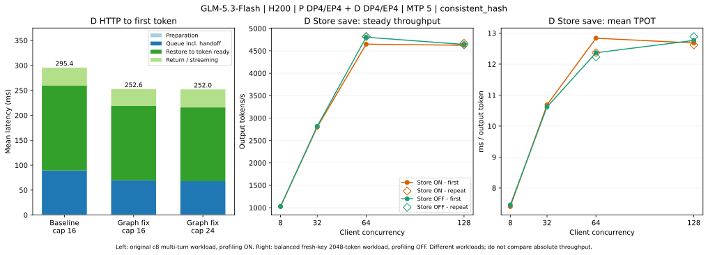

# GLM-5.3-Flash PD 恢复路径与 Store 保存性能验证（2026-11-20）

修正混合 DP 批次的 graph 匹配后，同配置下 D 首 token 均值从 **295.41 ms 降至 252.56 ms（−14.5%）**，整体 TTFT 从 **658.57 ms 降至 587.54 ms（−10.8%）**，吞吐基本持平。单独的 Store 保存对照未发现一致的饱和吞吐下降，但并发 64 的 TPOT 增加 1.14%～3.81%；不把两轮测试的小差值解释为确定的零开销或加速。



## 范围与部署

延续周报第 7 节的第二项验证。第一项精度定位与完整回归见 [精度报告](mooncake_pd_accuracy_h200_20261120.md)。本报告区分两组实验：原始多轮业务的 D 首 token 分阶段测量，以及均衡路由下 D Store 保存开/关的并发曲线。两组负载和 profiling 设置不同，吞吐不直接横向比较。

- 机器：`ailab@gpu-l-lg-cmc-h-h200-0382`，容器：`lmdeploy_new_version_1106`，8 × H200。
- 代码基线：`b3e154fe`；模型：GLM-5.3-Flash，checkpoint `3f1971b7b5f7a528c9c4ef6212c8785298a8c24a`。
- P/D 各 4 GPU，分别 DP4/EP4/TP1；MTP 5；每 rank 最大 batch 16；cache fraction 0.7。
- P piecewise graph 上限 64；D piecewise 上限 16，full decode graph batch 为 1/2/4/8/16。
- Mooncake Transfer Engine CUDA 13：0.3.14；Store 每 rank segment `64GB`（64 GiB）、local buffer `4GB`，segment 均位于同一台 H200 主机；P 为 `kv_both`、D 为 `kv_producer`。
- 保留 `--prefix-cache-decode-save-first --prefix-cache-decode-state-interval 1024`，本地 state budget 16。
- Router 使用 `consistent_hash`；先建立并预热全部 16 个 P/D 连接，再预热业务负载。

## D 首 token 的耗时归属

使用用户的 `run_glm53_shorttask_382_full_kvcache.sh`：SWE_smith，首轮约 32K、后续每轮增加 4K，共 5 轮；8 会话、并发 8、每次输出 512 token。预热两遍，正式三遍，共 120 个请求；全部成功。本地缓存命中率 99.904%，正式窗口无 graph capture。原始 session key 保持不变，D rank 请求分布为 1/4/2/1。

新增 opt-in 计时以 `(角色, dp_rank, ssm_state_access_id)` 关联 engine dispatch、worker 接收、输入预处理、DP 等待与 CUDA event。计时不增加 device synchronize，关闭 `LMDEPLOY_PROFILE_PHASES` 时不构造这些记录。以下为请求加权统计；一个恢复批次覆盖多个请求时，其耗时计入各请求。

| 指标                       |      均值 |       p50 |        p99 |     最大值 |
| -------------------------- | --------: | --------: | ---------: | ---------: |
| 整体 TTFT                  | 658.57 ms | 621.26 ms | 1032.07 ms | 1039.22 ms |
| TPOT                       |   7.90 ms |   7.83 ms |   10.24 ms |   10.59 ms |
| D HTTP 至首 token          | 295.41 ms | 264.56 ms |  671.27 ms |  685.05 ms |
| D 请求准备                 |   1.46 ms |   1.43 ms |    2.27 ms |    2.46 ms |
| D 入队至首次调度（含交接） |  88.01 ms |  66.30 ms |  349.05 ms |  384.79 ms |
| 其中：接收完成至调度       |  18.58 ms |   2.85 ms |  157.61 ms |  160.15 ms |
| D 首次调度至首 token 就绪  | 169.94 ms | 151.41 ms |  432.91 ms |  432.98 ms |
| native RDMA（交接内）      |   5.80 ms |   5.41 ms |    9.98 ms |   10.23 ms |

输出吞吐为 **804.10 token/s**。D HTTP 至首 token 的均值 295.41 ms，可分为准备 1.46 ms、入队至调度 88.01 ms、调度至首 token 就绪 169.94 ms，以及输出回传/前端流式处理剩余 36.02 ms。RDMA 5.80 ms 已包含在交接路径中，不能再次相加。接收完成后的调度等待均值 18.58 ms、p99 157.61 ms，表明尾部存在明显排队。

恢复执行的 169.94 ms 进一步拆分如下：

| 阶段                             |      均值 |       p50 |       p99 |    最大值 |
| -------------------------------- | --------: | --------: | --------: | --------: |
| 调度至 dispatch                  |   0.85 ms |   0.78 ms |   1.68 ms |   1.79 ms |
| executor 等待/投递至 worker 接收 |  19.86 ms |   5.83 ms | 149.46 ms | 158.17 ms |
| 接收至预处理完成                 |   0.72 ms |   0.61 ms |   3.98 ms |   5.12 ms |
| 预处理完成至 worker 执行         |   1.28 ms |   1.27 ms |   5.48 ms |  10.62 ms |
| worker 准备                      |   0.23 ms |   0.17 ms |   0.49 ms |   0.51 ms |
| DP 同步等待                      |   5.87 ms |   1.43 ms |  19.27 ms |  21.64 ms |
| CUDA stream 整段                 | 133.65 ms | 125.71 ms | 407.39 ms | 407.39 ms |
| 其中：target                     | 123.45 ms | 114.97 ms | 396.06 ms | 396.06 ms |
| 其中：sampling + draft           |   9.63 ms |   9.48 ms |  12.87 ms |  13.41 ms |
| 其中：finish                     |   0.57 ms |   0.58 ms |   2.06 ms |   2.17 ms |
| stream 待执行与输出返回余量      |   7.45 ms |   1.03 ms |  24.00 ms |  39.53 ms |

CUDA event 的 stream 时间包含 kernel、collective 和 launch 间隙，不能称为纯 GPU kernel 时间。CPU 提交耗时均值 139.60 ms 与 stream 执行重叠，不能把两者相加。投递至 worker 的区间也包含 executor 前序任务等待与 worker 可接收调度的等待，不等同于 Ray 传输本身。

所有 D 恢复 query 都为 1 token。它们走 prefill/piecewise 路径，后续 MTP uniform decode 才走 full graph。当前 KDA 的卷积、递推和状态更新，以及相关 MoE 边界仍在 piecewise 的 eager 边界执行；源码结构与 target/提交耗时说明后续应优先研究这条恢复路径的 graph 覆盖。现有证据没有把 123.45 ms 全部归因于 KDA kernel，不能据此推算单个 kernel 的优化收益。

## 投递优化实验与取舍

在测试副本中尝试 TP=1 时直接把输入传给 Ray actor，省去显式 `ray.put`；TP>1 仍共享对象。两遍预热、三遍正式测试的请求内容与基线一致，缓存命中率一致，正式阶段均无 graph capture。

| 指标               |           基线 | Ray inline 候选 |
| ------------------ | -------------: | --------------: |
| TTFT               |      658.57 ms |       643.02 ms |
| TPOT               |        7.90 ms |         7.98 ms |
| D HTTP 至首 token  |      295.41 ms |       285.27 ms |
| 投递至 worker 接收 |       19.86 ms |        19.14 ms |
| 输出吞吐           | 804.10 token/s |  788.01 token/s |

候选并未稳定缩短它所针对的投递区间，吞吐下降约 2.0%。TTFT 均值的小幅下降不足以证明优化有效，故已还原，未合入生产代码。也没有改用不同的 KDA 数值路径来缩短恢复：第一项已经证实 chunk 边界会影响有限精度结果，改变该路径需要单独设计和精度回归。

## 修正混合 DP 批次的 piecewise graph 匹配

按全局 worker step 对齐 D 的 4 个 EP peer 后发现：基线的恢复批次中，另一些 rank 正在处理本地 decode/dummy，虽然只有 6 或 12 token，仍全部走 eager。最慢例子的恢复 target 为 396 ms，同一 EP 组其他 peer 也约 396 ms；只看恢复 rank 自己的 query=1 会遗漏这一等待来源。

根因是 GLM 的 `prepare_inputs_for_generation()` 按**本地** `context.is_decoding` 决定 `return_input_embeds`。启动时以 prefill 捕获的 piecewise plan 使用 `True`，而混合批次的本地 decode rank 使用 `False`；这个 forward constant 属于 graph descriptor，因此查不到已有 plan。原实现的正式恢复 step 中，297 条本地 decode peer 记录全部为 eager。

修正为按 `context.global_is_decoding()` 决定输出契约：混合 DP 批次共享 prefill plan；uniform decode 仍保持原先的 full graph 输出契约。GLM target/draft 共享同一 embedding 模块，修正没有更换 KDA kernel 或改变 PD 的 token 切分。新增一个精简 CPU 回归，使用真实模型准备逻辑和真实 graph descriptor 检查该匹配；旧代码失败、修正后通过。另运行 9 个现有 target/embedding/graph 输出契约用例，全部通过。

先保持原有 D graph 上限 16，只测代码修正。两遍业务预热后，三遍正式请求的 body hash 与基线相同，缓存命中率一致，formal graph capture=0。294/333 条本地 decode peer 记录命中 piecewise，剩余 39 条为超过上限的 18/24-token 批次。

| 指标                            |  基线，上限 16 | 修正后，上限 16 | 修正后，上限 24 |
| ------------------------------- | -------------: | --------------: | --------------: |
| 整体 TTFT 均值                  |      658.57 ms |       587.54 ms |       599.80 ms |
| D HTTP 至首 token 均值          |      295.41 ms |       252.56 ms |       252.05 ms |
| D HTTP 至首 token p99           |      671.27 ms |       408.65 ms |       496.82 ms |
| D 入队至首次调度                |       88.01 ms |        68.34 ms |        66.46 ms |
| 接收完成至调度                  |       18.58 ms |        14.84 ms |        14.92 ms |
| D 首次调度至首 token 就绪       |      169.94 ms |       149.36 ms |       147.93 ms |
| 恢复 target stream              |      123.45 ms |       102.32 ms |        98.94 ms |
| 恢复 CPU 提交（与 stream 重叠） |      139.60 ms |       119.31 ms |       115.46 ms |
| TPOT                            |       7.903 ms |        8.000 ms |        7.791 ms |
| 输出吞吐                        | 804.10 token/s |  804.19 token/s |  810.04 token/s |

同配置下 D 首 token 均值降低 **14.5%**，整体 TTFT 降低 **10.8%**，吞吐基本持平；没有观察到 TPOT 改善。三轮 D 首 token 分别为 242.04/270.40/245.24 ms，基线为 323.19/274.38/288.67 ms。排队时序也随 peer 执行改变，不能把整个 TTFT 差值都当作单个 graph kernel 的收益。

上限 16 的修正版本重新执行 27 组、108 次短边界请求，4 种调用顺序的输出 token ID 均与第一项的修正前基线逐一相同；已有短边界 PD/direct 差异仍保留，没有用性能改动掩盖精度差异。

再单独将 D piecewise 上限改为 24，P 仍为 64，full decode batch 不变。重复完整连接/业务预热及三遍正式测试，120 请求全部成功、缓存命中率相同、formal capture=0。此时 310/310 条混合批次的本地 decode peer 记录全部命中 piecewise；当前 8 会话分布下单 rank 最多 4 条 MTP 序列，对应 `4×(5+1)=24` tokens。

上限 24 的 D 首 token 均值相对 16 仅少 0.52 ms，p99 反而更高，未证明扩大上限有稳定的额外收益。因此合入的是 graph 匹配修正和测量能力，不提高通用默认上限。24 可用于覆盖本负载的混合 batch；更高并发应按实际 token bucket 另测，不能只提高一个最大值就假定所有中间形状都会被捕获。完整精度回归使用上限 24，覆盖这次额外的混合 graph 路径。

## 单独测量 D Store 保存的代价

### 对照条件

此组采用原始 graph 实现，不混入后述 graph 修正；关闭 phase profiling。P Store 始终开启，D 保持 `kv_producer`、本地 prefix cache、save-first、1024 间隔和相同显存/Store 容量。OFF 仅在实验副本中阻止 D 的 Store 导出计划和保存请求，本地 state checkpoint 仍执行。该开关不进入生产代码。

使用相同 SWE_smith 首轮约 32K 上下文，每个请求附加唯一的 trial/request 后缀，输出固定 2048 token、greedy、ignore EOS。相同并发及轮次的 ON/OFF 请求 body hash、session key 和数据集 hash 全部相同。新增 [测试脚本](../benchmark/mooncake_pd_store_benchmark.py) 保存每个请求的时间、usage、输入/输出 hash 和 SSE chunk 时间。

仍使用 consistent_hash；从 64 个候选 key 中选出 8 个固定 key，使 P/D 各 rank 分别承接 2 个会话。部署后先预热 16 条连接、8 个基础上下文，再执行两轮并发 32、输出 2048 的业务预热。正式并发 8/32/64/128 分别发送 64/64/128/256 个请求。随后反序重测并发 64/128；整体顺序为 ON → OFF → ON。每次重启 Store，正式轮次采用新后缀，避免已经保存的 key 把写入退化为 exists 检查。

最初 ON 的预热未建立公共前缀 state checkpoint，P 仍进行长 prefill，故中止试跑 `c8_a`，产生 8 个主动取消请求；这批数据不进入统计。补上基础上下文预热后，正式 P 缓存命中率均为约 99.796%，ON/OFF 一致。正式请求无 API 错误。

### 并发曲线与重复结果

表中吞吐包含整个业务窗口的填充与排空；TPOT 为每请求 `(完成时间−首文本 chunk 时间)/(completion_tokens−1)` 后的均值，包含流式输出与末尾回传开销，不是 kernel 耗时。

| 轮次     | 并发 | ON 吞吐 token/s | OFF 吞吐 token/s | ON TPOT ms | OFF TPOT ms | TPOT 变化 |
| -------- | ---: | --------------: | ---------------: | ---------: | ----------: | --------: |
| 首轮     |    8 |          934.35 |           944.43 |      7.402 |       7.456 |    −0.72% |
| 首轮     |   32 |         2521.13 |          2593.21 |     10.684 |      10.618 |    +0.62% |
| 首轮     |   64 |         4040.99 |          4271.59 |     12.837 |      12.366 |    +3.81% |
| 首轮     |  128 |         4364.72 |          4280.98 |     12.681 |      12.765 |    −0.66% |
| 反序复测 |   64 |         4221.96 |          4250.03 |     12.371 |      12.231 |    +1.14% |
| 反序复测 |  128 |         4427.68 |          4175.38 |     12.616 |      12.890 |    −2.12% |

为避免结束阶段与队列填充影响，另统计窗口中间 60% 的服务端 generation counter 增量。running gauge 每 10 秒更新，分析同时排除开头 10 秒。并发 128 的 D 活跃请求中位数为 62～63，最大 64，中间窗口所有样本均至少 56；达到本配置 4×16 的调度容量。并发从 64 提高至 128 时，稳态吞吐停留在约 4.6～4.8K token/s，TTFT 升至约 22～23 秒，主要增加了排队。

| 轮次     | 并发 | ON 稳态 token/s | OFF 稳态 token/s |   变化 | ON/OFF MTP 平均接受长度（含目标 token） |
| -------- | ---: | --------------: | ---------------: | -----: | --------------------------------------: |
| 首轮     |   64 |         4648.27 |          4803.61 | −3.23% |                         4.0330 / 4.0824 |
| 反序复测 |   64 |         4818.61 |          4817.86 | +0.02% |                         4.0724 / 4.1010 |
| 首轮     |  128 |         4624.09 |          4642.12 | −0.39% |                         4.1050 / 4.0807 |
| 反序复测 |  128 |         4671.98 |          4631.15 | +0.88% |                         4.0932 / 4.0704 |

**当前证据不支持 Store 保存是饱和吞吐的主要瓶颈。** 并发 64 的 TPOT 有 1.14%～3.81% 增幅，业务吞吐下降 0.66%～5.40%；并发 128 没有复现下降。两轮不足以估计稳定的小幅开销或给出置信区间。批次时序改变后，即使 greedy 也出现生成内容和 MTP 接受率变化，因此不能把 ON 某些指标更好解释为 Store 带来的加速。

### 实际保存、队列与完成状态

| ON 轮次/并发 | 成功 native put | 实际写入 GB（十进制） | native 均值 / p99 ms | 保存队列均值 ms | 入队至完成均值 ms |
| ------------ | --------------: | --------------------: | -------------------: | --------------: | ----------------: |
| 首轮 / 8     |             128 |                19.779 |          4.41 / 5.17 |            0.53 |             46.81 |
| 首轮 / 32    |             128 |                19.779 |          4.27 / 5.15 |            9.08 |             66.14 |
| 首轮 / 64    |             255 |                39.416 |          4.20 / 5.02 |           15.81 |             77.33 |
| 首轮 / 128   |             512 |                79.129 |       10.57 / 135.18 |           16.86 |             84.57 |
| 反序 / 64    |             256 |                39.564 |          4.30 / 5.16 |           17.04 |             73.79 |
| 反序 / 128   |             512 |                79.130 |          4.24 / 5.11 |           17.38 |             77.16 |

这些计数来自实际缺失 key 的 native put，而非计划保存字节数。OFF 的 D put 次数和字节数均为 0。所有正式已入队保存都成功完成，pending=0；最后一次保存完成均早于业务结束，额外 10 秒排空观察未发现积压。此处“完成”是保存 worker 的完成日志，未单独测量 owner 后续释放 lease 的时刻。

首轮并发 64 有一个请求只入队了第二个保存边界，故为 255 而非 256 次；全部 128 个请求均至少保存一次。这是保存覆盖率差异，不能计为已入队任务失败；日志不足以断言具体跳过原因。复测并发 64 为 256 次，两个并发 128 均为 512 次。

Store master 峰值占用：首轮 ON 262.37 GiB、OFF 100.82 GiB、复测 ON 181.40 GiB，总容量均 512 GiB（master 日志把 1024 进制单位显示为 GB）；无 eviction、allocation failure。首轮并发 128 的 native p99 尖峰未在反序测试复现，也没有形成持续保存积压。

本组隔离的是“导出并保存 D 生成的 KV/state”的代价；没有消费这些生成后缀来测后续命中收益，也没有关闭本地 state checkpoint。因此结果不能外推为完整 prefix-cache 功能开/关的代价，或远端 Store 网络拥塞时的上限。

## 修正后的完整精度回归

补充回归仍使用 GSM8K 全量 1,319 题、固定 4-shot、EvalScope 1.8.1、seed 42、并发 16、temperature 1.0、top_p 0.95、max_tokens 10240、stream=true；D piecewise 上限为 24，其余模型与 graph 参数如前。直接推理使用同一组 D workers，经独立 consistent_hash router 访问。

| 版本 / 配置           |                  PD |     同组 D 直接推理 | API 错误 |
| --------------------- | ------------------: | ------------------: | -------: |
| 第一项基线，D 上限 16 | 1284/1319（97.35%） | 1286/1319（97.50%） |    0 / 0 |
| graph 修正，D 上限 24 | 1281/1319（97.12%） | 1275/1319（96.66%） |    0 / 0 |

修正版本共同答对 1264 题、共同答错 27 题，PD 独有正确 17 题、直接推理独有正确 11 题。PD 的样本 119 达到 10,240-token 输出上限，reasoning 未结束，按原配置计为答错；其余 1318 个 PD 响应及全部直接推理响应正常 stop，直接推理最大输出 6330 tokens。没有删除、换种子或单独重跑错题。

相对第一项基线，本次 PD 少答对 3 题、直接推理少答对 11 题。测试采用随机采样，graph 上限与缓存运行状态也不同；这组结果完成了新版的全量覆盖，不能据此证明精度提升或严格的非劣效性。上限 16/24 两组边界复测共 216 次请求则均与第一项对应输出逐 token 一致。

修正版本 P/D 服务日志无 ERROR 或隔离事件。精度回归延续同一 Store，直接推理后段达到高水位，记录 6 次成功驱逐、6842 keys、约 42.64 GiB，峰值占用 485.51 GiB，无 allocation failure；这与前面的无驱逐 Store 性能对照是不同阶段。两组完整预测、reviews、停止原因及题目差集均归档。

## 后续优化重点

修正后的恢复 target stream 仍约 99～102 ms，接收完成至首次调度均值约 15 ms、p99 约 123 ms，executor 投递至 worker 接收均值约 17～20 ms、p99 约 119～128 ms。下一步应针对恢复过程的 eager 边界、CPU 提交与前序批次等待做进一步分析；这些区间都显著大于约 6 ms 的 native RDMA。扩大 piecewise 上限已经做过独立对照，本负载没有证明其额外延迟收益。

Store 保存可继续保留。当前同机内存 Store 的实际写入和队列已测量，当前测试未显示保存线程成为饱和吞吐的主要限制；若部署到跨机 Store、降低 segment 容量或提高保存频率，需要在相应条件下重新测量。

## 复现与产物

[汇总 JSON](../benchmark/results/mooncake_pd_restore_store_perf_h200_20261120.json) 包含环境及源码 SHA256、各阶段均值/p50/p99、逐轮结果、实际 graph 模式、Store 字节与完成计数、全量精度和边界输出核对。[图表](../benchmark/results/mooncake_pd_restore_store_perf_h200_20261120.svg) 使用这些数据绘制。

本机原始客户端目录为 `.git/pd_perf_followup_20261120/`；H200 上的归档路径为：

```text
/mnt/nvme1n1/ml_research/caikun/dev/code/v6/lmdeploy/runs/hybrid_attn/glm53_flash/perf_test/lmdeploy_pd_restore_store_perf_20261120.tar.gz
```

归档保存测试源码副本、P/D/router/Store 日志及 `client_artifacts/`：

- `launch.py`、`bench.py`：完整部署参数、16 条连接预热、原始多轮工作负载与稳定 session key。
- `analyze_phases.py`、`detail.py`、`mixed_summary.py`：按 response/session/access identity 关联前端、engine、worker 与同一 EP step。
- `store_stage.sh`、`base_warm.py`、`curve.py`、`session_keys.json`：Store 对照与均衡 consistent_hash 路由；`scheduler_store_control.py` 保存仅供实验的 D 导出开关。
- `store_analysis.py`：实际 put 字节、保存队列/完成时刻、Prometheus counter 与并发样本。
- `probe.py`、`probe_graph24.py`、`gsm_graph_*.yaml`、`full_accuracy.py`：修正后边界验证和全量评测。
- 被排除的冷前缀试跑、被撤回的 Ray inline 候选及所有原始预测也保留，未只保存成功或较快的轮次。

基线有一条与恢复请求无关的 decode worker trace 被 Ray 日志交错截断，解析器显式报告并跳过；正式 120 个恢复请求的所需阶段全部成功关联。基线第一次预热出现 5 次 Store lookup EAGAIN 并按 miss 回退，均早于正式窗口。主动结束测试服务时的 engine-exit 日志不计为业务失败。
