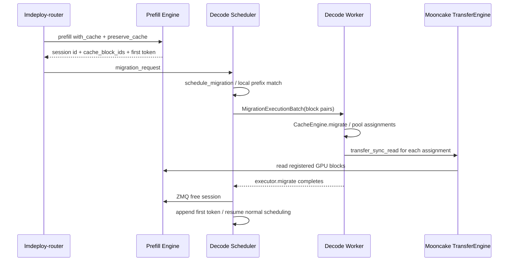
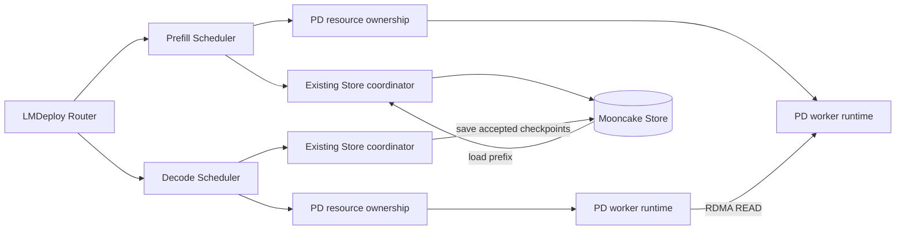
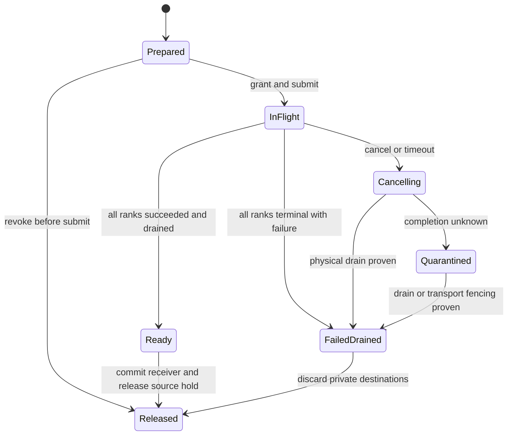

# LMDeploy Mooncake Store 与 PD 分离设计评审稿

本设计对应 [原始任务](support_mooncake_store_mooncake_pd_same_time.md)。目标是让 GLM-5.3-Flash 在 PyTorch 后端同时使用 Mooncake Store、Mooncake PD、双端 prefix cache 和相同的 MTP 配置，并支持 attention TP 相同、DP/EP 不同的 Prefill/Decode 集群。

建议保留现有 Store connector 和 Decode 主动拉取的 PD 通道。补齐完整的缓存迁移描述、以 paging 为所有者的 PD 事务、精确的生成边界，以及 router 的取消协议。连续段合并和批量提交属于这次交付。无需为了组合这两个功能引入通用 MultiConnector，也无需重做已有 Store 的 checkpoint 体系。

状态：待确认整体设计及子任务；本轮只有源码调研和设计文档，没有实现、部署、运行性能测试或提交代码。

## 1 范围和版本

### 1.1 交付范围

| 项目         | 约定                                                                                                   |
| ------------ | ------------------------------------------------------------------------------------------------------ |
| 后端         | LMDeploy PyTorch；实机验收使用指定 H200 CUDA 环境                                                      |
| Prefill      | Mooncake PD + Store `kv_both` + 可选本地 prefix cache                                                  |
| Decode       | Mooncake PD + Store `kv_producer` + 可选本地 prefix cache                                              |
| 缓存类型     | MHA/GQA 的 K/V 与量化附属数据；MLA/DSA；KDA/GDN 的 recurrent/conv state；GLM KPool 与 tail；MTP cache  |
| 并行配置     | P/D 的有效 `attn_tp` 相同；各自 DP、EP 可以不同；各实例内部 target/MTP 拓扑一致                        |
| MTP          | 两端模型、方法、宽度、cache schema 一致；GLM 使用当前 `deepseek_mtp` 路径，覆盖已有 MTP 所需的交接语义 |
| 正确性       | 不覆盖共享 prefix；不读取未完成的数据；I/O 未排空的 block、state、auxiliary slot 不得复用              |
| 不扩展的范围 | DCP、异构 TP、PP 重分片、Turbomind，以及新的非 CUDA state backend                                      |

已有 `block_size != kernel_block_size` 的 PD 限制暂时保留。当前 GLM 已经使用 logical64/kernel64，KPool 每个 owner 含 16 个压缩条目；支持这个布局不需要顺带实现任意 logical/kernel 拆分。

### 1.2 调研基线

调研日期为 2026-11-11。实现结论以用户指定的本地 checkout 为准。

| 仓库            | 路径                    | HEAD                                       |
| --------------- | ----------------------- | ------------------------------------------ |
| LMDeploy        | `/data/code/lmdeploy`   | `cf52797ec6890fb6fe99aee8c4768d209d5a720b` |
| vLLM            | `/data/code/vllm`       | `e740badc2e3df13a5c2abfca04ed0ac917985c5f` |
| SGLang          | `/data/code/sglang`     | `a93e89fd4a4eefb52c3ce73a609317d716d2a6ab` |
| lmdeploy-router | `/data/code/dev/router` | `73123977ec6b36f463ad69b01679545b99e0c40f` |

LMDeploy 工作区存在大量既有未跟踪文件；它们不属于本任务的实现变更。其他三个 checkout 的 tracked 文件在检查时没有本地修改。后续只修改明确列入子任务的文件。

## 2 LMDeploy 当前实现与缺口

### 2.1 当前调用链

控制面入口是 [distserve.py](/data/code/lmdeploy/lmdeploy/serve/openai/endpoints/distserve.py)，请求传递经过 `chat_completions/serving.py`、`serve/core`、`engine_instance.py` 和 `engine.py`。数据面经 [engine_loop.py](/data/code/lmdeploy/lmdeploy/pytorch/engine/engine_loop.py:646)、executor、[CacheEngine](/data/code/lmdeploy/lmdeploy/pytorch/engine/cache_engine/engine.py:291) 和 [Mooncake backend](/data/code/lmdeploy/lmdeploy/pytorch/disagg/backend/mooncake.py:179)。

### 2.2 已确认的问题

| 问题                                           | 代码证据                                                                                                                     | 影响                                                                         |
| ---------------------------------------------- | ---------------------------------------------------------------------------------------------------------------------------- | ---------------------------------------------------------------------------- |
| GLM 明确禁止 PD                                | `configurations/glm5_next.py:update_cache_config()` 在 role 非 Hybrid 时抛错                                                 | 这是当前无法启动的直接原因；仅删除限制不能完成支持                           |
| PD 只管理 target block allocation              | `CacheEngine._resolve_pd_cache_pools()` 仅返回 `gpu_allocation.pools`；worker PD API 只调用 `model_agent.cache_engine`       | 独立的 `StateCacheEngine`、`spec_agent.cache_engine` 都未接入                |
| pool 描述只适用于同一个 block ID 空间          | `describe_cache_pools()` 要求每个 pool 的 entry 数都等于 `num_gpu_blocks`                                                    | state unit、request auxiliary slot 不能简单拼进列表                          |
| Store 的持久化字段不等于 PD 的恢复字段         | GLM KPool tail 标记 `store_cacheable=False / prefix_checkpoint=False`；MTP raw token cache 也不进入 Store                    | PD 在非 64-token 对齐处交接时仍然需要这些字段                                |
| migration admission 没有完整的 state admission | `schedule_migration()` 检查可用容量并 allocate block，但没有普通 prefill admission 中的 `state_manager.allocate(seq)`        | stateful Decode 不能依赖这条路径得到合法 bank 和 auxiliary slot              |
| 本地 prefix 命中后仍全量迁移                   | `schedule_migration()` 已有 tentative match；`_migration_loop_migrate()` 却 zip 全部 P/D block IDs                           | 冗余传输，且可能向已被其他请求共享的本地 prefix block 写入                   |
| 把两端整个 block table 长度相等当作前提        | `_migration_loop_migrate()` 的长度断言                                                                                       | MTP lookahead、预分配、有效 token 数与物理容量不必相同，应按有效区间迁移     |
| PD 缺少专门的取消与释放保护                    | `stop_session/end_session` 仅调用 `KVLoadCoordinator.defer_*_if_loading()`                                                   | PD `await` 期间取消可走到释放路径；线程中的传输不会随协程取消而停止          |
| 多 rank 失败没有排空契约                       | `RayExecutor.migrate()` 使用默认 `asyncio.gather`                                                                            | 一个 rank 抛错时，不能据此认定其余 rank 已停止访问缓存                       |
| router 直接释放 P cache                        | `PrefillCacheGuard::drop()` 调 `/distserve/free_cache`；服务端直接 end session                                               | 客户端断开或 D HTTP 出错，不能作为 P 端 RDMA read 已结束的证明               |
| MTP 完成恢复参数不完整                         | `update_running_migration()` 没有传 draft tokens；`ARSpecSequence._update_token_ids_prefill()` 会执行 `len(draft_token_ids)` | 缓存传输之外，还有确定的序列恢复接口缺口                                     |
| 同步逐段调用成本高                             | 每个 block 展开 `_entry_segments()` 和 Pydantic assignment，再逐个 `transfer_sync_read`                                      | Python 对象构造、日志格式化、调用和 RDMA 提交都随 layer × block 增长         |
| 引擎和 MR 绑定到每条连接                       | `MooncakeMigrationManagement.__init__()` 为每个 peer 创建 TransferEngine                                                     | peer 增多时重复初始化和注册；`p2p_drop_connect` 当前只关闭 ZMQ               |
| 握手没有完整的语义和实例代际                   | pool 只有 shape/dtype/entry axis；peer 主要按 URL 标识                                                                       | packed uint8 shape 相同不能证明内容相容，重启后旧 session/地址也不能继续使用 |

以上是静态调用链和接口检查结论。除明确抛错和参数不匹配外，竞态项表示代码中存在可达风险路径，不把它们写成已经在 H200 复现的故障。

### 2.3 可以直接复用的能力

1. `BlockCachePlan / CacheAllocation / CachePool` 已经提供 owning storage、entry axis 和统一的 backend layout。普通 KV、量化附属数据、operator cache 都应通过它们描述，无需在 PD backend 按模型名拼地址。
2. `StateCacheEngine` 已分离 compact unit allocation 与 request auxiliary allocation。`logical_state` 是 auxiliary ID，绝不能直接当成当前 recurrent state unit ID。
3. [KVSaveCoordinator](/data/code/lmdeploy/lmdeploy/pytorch/paging/kv_save_coordinator.py) 按 save operation pin 逻辑 block，完成后才释放；Store save 可以比请求活得更久。
4. [KVLoadCoordinator](/data/code/lmdeploy/lmdeploy/pytorch/paging/kv_load_coordinator.py) 已具备目标资源独占、延迟 stop/end、失败 rollback 和 worker drain 后清理的模型。
5. [SSMStateManager](/data/code/lmdeploy/lmdeploy/pytorch/paging/compact_state.py) 有精确的 `StateAccess / StateReference`，维护模型、Store 和 checkpoint 对 unit 的持有；`loaded_input=(unit_id, boundary)` 能表达接收后的首次恢复。
6. Store 已注册 target + MTP cache，并且在 speculative postprocess 之后才记录 save readiness。这个事件顺序也应成为 PD export 的条件。
7. `KVConnectorOutputAggregator` 已处理异步完成跨 rank 聚合；PD 需要遵守同样的 all-rank 原则，但拥有独立 operation ID，不能混入 Store save ID。

当前 `AssignmentInstruct` 的 source/target 命名沿用历史布局视角：在 Decode 执行 RDMA READ 时，`source_offset` 实际用于本地接收地址。扩展接口时应明确使用 local/remote offset 或明确的读方向，避免将现有命名误解成真实数据流向；这不是当前 READ 方向已经写反的结论。

Store worker 当前在同步 API 返回或异常后发送完成回调。它能保护 Python 调用在执行时的资源，但调用失败是否意味着 native RDMA 全部停止，仍必须由实际安装的 Mooncake 版本提供保证。这个问题同时影响 PD 和 Store。

## 3 vLLM 与 SGLang 的参考结论

### 3.1 vLLM

| 参考位置                                                                                                              | 当前本地实现                                                                                                   | 对 LMDeploy 的启发                                                                   |
| --------------------------------------------------------------------------------------------------------------------- | -------------------------------------------------------------------------------------------------------------- | ------------------------------------------------------------------------------------ |
| [MultiConnector](/data/code/vllm/vllm/distributed/kv_transfer/kv_connector/v1/multi_connector.py:133)                 | 选择第一个声明命中 token 的 connector 加载；向所有 connector 保存；统计额外异步 save，最后一个完成后才上报释放 | 借鉴多持有者完成条件；LMDeploy 已有独立 PD 通道，没必要为本任务迁成 MultiConnector   |
| [MooncakeConnector](/data/code/vllm/vllm/distributed/kv_transfer/kv_connector/v1/mooncake/mooncake_connector.py:2010) | 按 cache group 保留各自 block IDs；attention 与 Mamba state 不混用；按组裁剪本地命中部分                       | 引入明确的迁移 ID 空间，不能把 state slot 当普通 token block                         |
| 同文件 `_contiguous_runs`、`_can_coalesce_block_transfers`                                                            | 源、目标同时连续且覆盖完整条目时才合并；batch 提交                                                             | 优化以实际字节连续性为依据，不能只检查一端的 block ID                                |
| 同文件 `_get_remote_prefill_token_count`、`_truncate_mamba_request_for_prefill`                                       | stateful 路径采用 P 计算 N−1、D 重算最后 prompt token，以匹配 h(N−1)                                           | 状态必须对应准确的恢复位置；不能把这套 N−1 规则直接放进 LMDeploy 的首 token 交接协议 |
| 同文件 `_has_mamba` 注释                                                                                              | MambaSpec 路径明确说明当前测试对象为 GDN，Mamba2 尚未验证                                                      | 不能把通用接口等同于所有 state 模型已经通过精度验证                                  |
| [Store worker](/data/code/vllm/vllm/distributed/kv_transfer/kv_connector/v1/mooncake/store/worker.py:1595)            | 本地基线中 Store 拥有自己的 TransferEngine；异步 save ledger 保留到 jobs drain                                 | 共存不必强制共用 TE；资源生命周期是主要约束                                          |

在线 [vLLM Store 使用文档](https://docs.vllm.ai/en/latest/features/mooncake_store_connector_usage/) 同样介绍 PD 与 Store 组合，并已出现 `reuse_pd_transfer_engine` 配置，比本地基线更新。本文的具体源码分析仍以本地 SHA 为准；不能把网页新增选项视为本地已具备的接口，也不直接照抄网页上的角色示例替代本任务指定的 D `kv_producer`。

### 3.2 SGLang

| 参考位置                                                                                                        | 当前本地实现                                                              | 对 LMDeploy 的启发                                                             |
| --------------------------------------------------------------------------------------------------------------- | ------------------------------------------------------------------------- | ------------------------------------------------------------------------------ |
| [decode.py](/data/code/sglang/python/sglang/srt/disaggregation/decode.py:1159)                                  | 先 match 并锁住可复用 prefix，准备缺失目标区域；state、SWA 等资源分别处理 | D 本地命中应体现在传输区间和目标独占性上                                       |
| [prefill.py](/data/code/sglang/python/sglang/srt/disaggregation/prefill.py:531)                                 | 接收 `decode_prefix_len`，据此设定发送起点                                | LMDeploy 的 pull 模型可在 D 端直接裁剪，无需改成 P push                        |
| [common/utils.py](/data/code/sglang/python/sglang/srt/disaggregation/common/utils.py:135)                       | `group_concurrent_contiguous` 同时检查 src/dst 相邻性                     | 可以用等价的 run 规划替代逐层逐块对象展开                                      |
| [mooncake/conn.py](/data/code/sglang/python/sglang/srt/disaggregation/mooncake/conn.py:405)                     | KV、aux、各类 state buffer 分别描述；注册时对完全相同的区域去重           | 注册 owning allocations，保留语义分组；避免对同一分配重复注册                  |
| `prefill.py / decode.py` 的 draft buffer 构造                                                                   | target 与 draft 分别收集，必要时使用独立索引向量                          | 即使 LMDeploy target/MTP 共用逻辑 block ID，也应保留不同 pool 的身份和有效范围 |
| [mooncake_store.py](/data/code/sglang/python/sglang/srt/mem_cache/storage/mooncake_store/mooncake_store.py:620) | 配置兼容时复用共享 TE，否则创建独立实例                                   | 共享 TE 有配置和 MR 所有权前提，不是无条件优化                                 |
| `prefill.py:process_disagg_prefill_transfer_queue`                                                              | 对 transfer 完成做 rank 共识后处理请求                                    | 单 rank 完成不能代表整个请求完成                                               |

SGLang 本地 [prefill.py 的 `_send_done`](/data/code/sglang/python/sglang/srt/disaggregation/prefill.py:244) 还保留了一个 TODO：failed/cleared room 的发送释放缺少 quiescence 证明。因此参考其结构和性能方法，但不照搬该失败释放行为。本任务的内存安全要求需要更严格的完成条件。

官方 [SGLang PD 文档](https://docs.sglang.io/docs/advanced_features/pd_disaggregation) 也将传输线程、队列和提交批量作为独立的调优项。这里只采用与同 TP、CUDA 场景直接相关的能力，不引入异构 TP staging。

## 4 整体架构

### 4.1 各模块的责任

| 所有者                                     | 负责什么                                                                 | 不负责什么                                      |
| ------------------------------------------ | ------------------------------------------------------------------------ | ----------------------------------------------- |
| CacheEngine / StateCacheEngine / SpecAgent | owning allocation、模型 cache 的布局与语义                               | 请求取消、router 行为、跨请求资源释放决策       |
| ModelAgent 下的 PD worker runtime          | 汇总以上 cache 描述；注册；ready event；批量 I/O；保留 native 完成对象   | 分配、回收 paging block 或 state unit           |
| Paging 的 PD migration coordinator         | P export 和 D receive 的资源持有；admission；提交、完成、取消与 rollback | Mooncake 调用和按模型拼装指针                   |
| 已有 Store coordinator                     | Store lookup/load/save 及其已有 block/state 持有                         | 替 PD 提前释放资源                              |
| EngineLoop / Executor                      | 调度 PD，汇总全部参与 rank 的结果，交付 token 与正常模型计算             | 将单个 Future 异常解释为全部设备 I/O 完成       |
| Router                                     | 选 P/D、透传版本化 descriptor、取消请求和失效连接缓存                    | 推断 state ID、cache layout、物理显存是否可释放 |

建议新增一个明确拥有 PD 事务的 paging coordinator，以及一个 worker 端 cache 汇总与传输生命周期组件。复用已有 backend 实现传输适配，不再叠加 registry service、通用 transfer broker 或 callback framework。最终类名在实现时随职责确定。

### 4.2 缓存传输分组

| 资源组            | ID 空间                                  | PD 需要的内容                                      | Store 的现有行为                  |
| ----------------- | ---------------------------------------- | -------------------------------------------------- | --------------------------------- |
| target block      | scheduler 逻辑 block → owning pool entry | K/V、MLA、量化数据、KPool/DSA 等所有恢复所需 pool  | 仅持久化可缓存字段                |
| draft block       | 对应 MTP cache 的 block entry            | MTP KV、KPool、恢复时需要的 raw token cache        | MTP raw token cache 可以被排除    |
| compact state     | SSM unit ID                              | 在交接边界的 conv/recurrent 状态                   | 保存可恢复 checkpoint unit        |
| request auxiliary | auxiliary request slot ID                | GLM target KPool raw key/score ring 等请求私有内容 | 64-token 恢复不需要的字段可以排除 |
| legacy state      | legacy runtime slot ID                   | backend 所定义的完整恢复状态及必要 ring            | 沿用现有模型声明                  |

PD 默认传输所需 owning entry 的完整 payload，不使用 `store_cacheable` 或 Store 的 `transfer_ranges` 作为过滤规则。这样不会漏掉 GLM tail 和 MTP raw token 数据。模型无某个资源组时，该组为空，不构造虚假的 state/block IDs。

Pool metadata 扩展为语义身份、ID 空间、shape、dtype、entry axis、每 entry 的 payload，以及各自 capacity。每个资源组独立校验 capacity，不要求 state capacity 等于 KV block 数。target/MTP 的池按实际 `BlockCachePlan` 编译，不能硬编码“每层两个 K/V”。

握手校验执行 schema：模型配置及部署提供的权重版本标识、量化、有效 attention TP、cache geometry、ordered tensor specs、state 模式、MTP 方法/宽度/模型配置。capacity 和 DP/EP 不进入相容性等式；它们可以不同。packed uint8 的字节 shape 相等不是充分条件。

### 4.3 PD 与 Store 的 TransferEngine

首版建议每个 worker 一个 PD TransferEngine，多个 peer 共享该引擎的本地注册；peer 对象只保存远端 endpoint 和 layout。Store 保持自己的引擎和关闭流程。

这解决当前每 peer 重复注册，同时避免立刻重做 Store 的行级注册与 PD 整池注册之间的重叠 MR 管理。两者访问同一缓存时，由 paging 的引用和读写顺序保证安全。是否进一步共用 TE，依据注册成本、MR 资源、带宽竞争的实测决定；它不作为完成共存功能的前提。

## 5 交接协议和正常流程

### 5.1 明确 token 边界

定义 `N` 为完整 prompt 长度，`R` 为 D 必须补算的尾部长度，`H = N - R` 为交接边界。首版现有单模块 MTP/普通 AR 统一 `R=1`；`N=1` 时不发起数据迁移，由 D 完整执行。

P 只计算 `[0,H)`，交接 target/draft KV、`S_H` 和辅助 tail。D 保留完整 prompt，从 H 开始正常 prefill，重新产生 `y1` 和自己的 drafts。P 的采样 token、draft token、hidden states 不交接。递推 state 不能倒退，因此禁止加载 `S_N` 后重放最后一个 prompt token。

P 最后一个 shifted MTP cache row 使用已知 prompt token `x_H`，不能使用 P 的采样结果替代。Store/local prefix 的 lookahead identity 保留该真实 token；有效 target KV 上限仍为 H。未来多模块 MTP 必须按模型契约扩大 R，不能仅修改 token 计数。

### 5.2 版本化 descriptor

扩展现有 `MigrationRequest` 相关结构，嵌入一个版本化的 handoff descriptor，包含：

- `transfer_id`、P engine incarnation/epoch、协议/schema 版本；session ID 只是关联字段。
- 实际 P DP endpoint / DP rank、有效 attention TP 信息。
- `valid_token_count=H`、`prompt_token_count=N` 和经过校验的 prompt/执行身份。
- 各资源组的有效 block IDs、state unit ID、auxiliary slot ID；按需要提供 rank 局部 ID。

指针和 MR 信息留在经过握手的 endpoint 描述中；router 不构造字节地址。新的混合缓存能力要求新协议，旧 peer 在握手阶段得到明确的不兼容错误。没有足够证据的旧单池推断不能用于 hybrid/MTP。

允许无 block 但有 state 的描述，以覆盖纯 state 模型。现有 router 的 `remote_block_ids` 非空要求需要随协议更新。

### 5.3 Prefill 侧

1. 按现有流程先匹配 local prefix，再 lookup/load Store，完成缺失 prefill。
2. 最后一次 target forward 和 MTP cache 写入完成后，建立 PD export。ready event 要位于 speculative postprocess 之后，并以全部参与 TP rank 完成为发布条件。
3. Export 持有冻结的源 block、精确的当前 state、auxiliary slot 和必要模型引用。P 不再对这份 export 执行模型写入；Store 可以同时读取满足其持久化条件的部分。
4. Compact state 的当前 unit 以 worker 实际选择为准。优先复用已有已知 final reference；否则随现有输出事件返回少量 current-unit ID 元数据，避免复制大块 state，也不能猜测 `logical_state == unit_id`。
5. 返回 descriptor。持有在 descriptor 可见前建立，不依赖 HTTP 响应对象、普通 session 存活或缓存淘汰策略维持。

P 中未被 D 领取的 export 可以在显式撤销后回收；已被领取的 export 需要 D 的物理完成证明，详见第 6 节。

### 5.4 Decode 侧

1. 校验 descriptor、engine epoch、执行 schema 和 token 边界。
2. 本地 prefix match 并 pin 命中块。MTP 查询身份使用完整 prompt 满足 lookahead，但可复用 target KV 的上限为 H。这里允许复用已验证的 immutable attention KV，不因为需要远端 `S_H` 而强制把可复用 FA 区间退到最近的 state checkpoint。为 PD 提供窄的 KV-only match 入口，保持普通 hybrid recompute 的 checkpoint 匹配语义。
3. 建立只读 prefix 与私有缺失区间；原子 admission block、state bank、auxiliary slot，以及首次恢复所需容量。容量不足时完整回滚 tentative match，保持 waiting。
4. 向 P 领取 export；P 将领取者绑定到 transfer ID 和 D incarnation。grant 完成前不提交任何 RDMA。
5. 只为未命中的资源生成传输计划。D 目标地址必须是私有、已保留且未被模型使用的地址。
6. 全部 rank、全部资源组成功后提交接收结果，安装 `S_H` 或对应本地 state reference，更新有效 KV 边界。
7. 通知 P terminal completion，幂等释放 PD 源持有。P 的 Store save 持有继续独立存在。
8. 将已计算边界设为 H，进入正常 prefill，补算原始 prompt 尾部后产生 `y1`。空数据迁移也要完成控制面 terminal 通知，不能遗漏 P 端释放。

只有接收事务成功后，D 的 Store producer 才能对该请求生成 save 计划。持久化继续要求完整、已接受的 block 和真实的对齐 state checkpoint；不能从 `S_H` 反推出较早的对齐 state，也不能把“P 已返回响应”当作“P 已完成 Store save”。重复 key 由现有 Store 查询/去重流程处理。

D 的停止条件和生成计数由正常 prefill/decode 路径处理，P 的采样不计入客户端输出。

### 5.5 Prefix 命中与部分 block

设可安全复用的完整本地 prefix 为 C token，则普通 attention block 从 `C / block_size` 开始迁移。以 B=64、H=2050、C=1984 为例：复用前 31 块，只接收覆盖最后 66 token 的两块。

最后一块若不完整，整块传输只能写进私有 block，且有效边界仍是 H；块内的 padding 或 speculative 尾部不成为有效缓存。不能为了少传几个字节向共享 prefix 的物理末块直接写入。必要时使用现有 COW/copy 机制。

FA KV、MTP KV、state 和 tail 的有效性分别判断。KV 全命中不代表 `S_N` 命中。只有本地 state 的精确边界等于 H 且所有必要附属状态有效，才能跳过相应 state 传输；否则仍拉取 `S_H` 和 tail。GLM 在 64-token 对齐处可以依据模型契约认定恢复 tail 为空；非对齐处必须保留实际 tail。

对于 Store 未保存的 MTP raw token 字段，仅在恢复确实不需要它们时省略；若缺失字段位于一个已经共享的物理块中，要先获得私有写目标，不能因标准 KV 命中而假设整个 owning allocation 都有效。

成功接收后可发布有充分有效性证据的 full blocks，以及确实收到的、满足本地 checkpoint 规则的 state；不伪造中间边界的 `S_C`。部分写入或失败的 state 不得挂到 trie。

## 6 生命周期和失败处理

### 6.1 两种完成不能混淆

请求结束、HTTP 出错、协程被 cancel、RPC 超时、某个 rank 报错，都是逻辑事件。它们不证明 native RDMA、其他 rank 或 CUDA 工作已经停止。

资源可复用需要同时满足：没有模型读写、没有 PD 读写、没有 Store 读写，且普通请求、trie、checkpoint 的引用计数也允许释放。PD 成功后无需等待 Store 保存完成才能让 D 生成，但源显存仍要受剩余 Store 引用保护。

### 6.2 事务状态

上图状态属于 PD operation；sequence 沿用并明确收敛已有 `MIGRATION_*` 状态，避免再维护一组含义相同的 running flags。完成记录必须携带 operation ID 和 incarnation，不通过可复用的 session/block 数字查找“当前对象”。

### 6.3 各类故障的行为

| 情况                                  | 处理                                                                                                  |
| ------------------------------------- | ----------------------------------------------------------------------------------------------------- |
| admission、schema 校验或 grant 前失败 | 尚未提交 I/O；回滚 tentative prefix、新分配资源和未提交的持有                                         |
| 用户 stop/end 或客户端断开            | 记录取消，阻止新提交；保留已提交访问的资源，直到全部 rank drain                                       |
| 部分资源/部分 rank 失败               | 请求整体失败；成功 rank 与未完成 rank 仍都需要收齐 terminal 结果；不启动 decode                       |
| 同步传输 API 返回负值或抛异常         | 只有版本契约证明已 drain 才释放；否则转 completion unknown                                            |
| Future 被取消                         | 不能取消后台线程或 native 操作的所有权；worker 保存原始任务/票据并继续收尾                            |
| P/D 断联或进程异常                    | 失效对应 incarnation；保留可能被访问的资源；完成 native drain 或经验证的 transport fencing 后才能复用 |
| 重复/延迟 release、迟到 callback      | 按 transfer ID + epoch 幂等处理；不得影响新操作                                                       |
| sleep、shutdown、cache reset          | 停止新 admission，排空 model/PD/Store 各自访问，再释放引用、MR 和 allocation；wakeup 使用新 epoch     |

`Quarantined` 不能成为无限吃内存的隐藏行为：记录数量和字节、限制新 admission，超出可恢复范围时将实例标为不健康并走明确的 teardown/restart。超时重试同一物理地址、TTL 到期直接回收、丢弃 ticket 都不是替代方案。

Mooncake 最新 [TransferEngine API](https://github.com/kvcache-ai/Mooncake/blob/main/docs/source/api-reference/python/transfer-engine.md) 已描述 drainable scatter ticket，并区分 `COMPLETED`、`FAILED_DRAINED`、`COMPLETION_UNKNOWN`。未知状态要求继续持有两端 buffer 和 registration。目标容器是否具备该接口、或现有 batch sync API 是否提供等价保证，必须在 T0 核实，不能从 API 的 “sync” 名称推断。

如果目标版本不能提供安全的完成契约，优先锁定可用的 Mooncake 版本/接口；若必须修改 native 层才能满足要求，应单独提交依赖变更设计，不以 Python 的 `try/except` 掩盖。不能宣称仅靠取消协程或分配新 block 就完全解决旧 native I/O 的寿命问题。

### 6.4 Router 取消与源端释放

P 的 export grant 与 revoke 必须在其 owner 上串行处理：

- revoke 先发生：未领取 export 被撤销，后到的 grant 被拒绝，D 不得开始读。
- grant 先发生：取消只能标记撤销意图并通知 D，不能释放 P 的源资源；等待 D terminal acknowledgment。
- D 的 grant 回复丢失或 D 崩溃：P 不能假定“没收到后续消息就是没开始”；沿用 unknown/quarantine 路径。

因此 router guard 改成取消 handoff 的控制面请求，而不是释放显存的命令。正常释放由 D 的 terminal 结果驱动。已领取 transfer 不允许仅靠超时回收源块。未领取 export 的超时撤销使用同一个原子 grant/revoke 规则。

## 7 MTP 恢复方案（已按 vLLM NIXL 修订）

依据用户提供的 `vllm_pd_mtp.md` 及 vLLM `e740badc2e` 的 NIXL backoff、scheduler 和 speculator，实现 prompt-tail replay。

1. P 在 prefix/Store lookup 前确定 H，实际 target prefill 停在 H，导出精确的 `S_H`。完整原始 prompt 的后续 token 仍参与 cache identity 和 MTP shifted 输入。
2. P 执行构建历史 MTP cache 必需的 forward；最后一个输入使用真实的 `x_H`。不会把 P 的 sampled token、proposal 或 hidden state 放入 handoff。
3. D 原子接收所有资源后，设置 `num_computed_tokens=H`，待计算输入仍为原 prompt `[H,N)`。compact state 经已有 `loaded_input=(unit,H)` 恢复，不额外再减一。
4. D 首轮 target 执行真实 prompt 尾部，从 `S_H` 推进到 `S_N`，得到 hidden state/logits 并采样 `y1`；MTP 使用这些 hidden states 和 `y1` 生成本地 drafts。首轮对外仅输出 `y1`。
5. D 第二轮才验证自己的 drafts。停止词、max_tokens 和输出计数全部复用普通生成路径，不再伪造一次 migration prefill 输出。

现有 LMDeploy 单模块 MTP 使用 R=1；两端继续要求相同 MTP 配置。多模块 MTP 不以未经验证的 replay 长度开放。P 后续 drafting 可后续优化，但任何额外 forward 都不得改变要导出的 target state 或有效历史 MTP rows。

验证覆盖 H mod 64、H mod 4、N=1、K>1、chunked prefill、Store 命中、lookahead、首轮输出计数及取消后 bank/block 不提前复用。

## 8 DP EP 路由和兼容性

`DistConfig` 会从实际 world size、DP 和 EP 配置计算 `attn_tp`；不能只比较最初的 `engine_config.tp`。`/distserve/engine_info` 应发布 runtime 已确定的 attention TP 和 cache geometry，router 与 worker 都据此校验。

P 与 D 的 attention TP rank 做一一对应。DP 只决定哪个实例持有该请求；EP 影响各端执行拓扑，不改变已经验证相容的 attention cache shard。握手、迁移结果聚合都限定在参与本次迁移的 attention TP ranks，不能要求 P/D 的整个 EP/world size 相等。

Store 继续使用既有确定性 hash、model/cache namespace、MTP lookahead 和 compact schema。DP/EP rank 与 PD transfer ID 不加入内容身份；FA 的 KV-head shard key 和 state 的 attention-rank key 保持各自现有语义，避免 MLA 的 KV 复制规则错误地合并了不同 rank 的 recurrent state。不同 DP/EP 的实例共享 Store 也要纳入 T7/T8 验收。

当前 LMDeploy 的 DP launcher 为各 rank 启动独立端口，应把每个实际端口注册为独立 worker。router 的通用 `base_url@rank` + header 模式不能代替 LMDeploy 并未实现的服务端 rank 分发。连接池以真实 P/D endpoint 和 incarnation 为身份；不能在多个 DP rank 之间混用一个 URL 的 MR 信息。

需要修改 `/data/code/dev/router` 的 `lmdeploy_pd_router.rs`：透传 descriptor、取消语义、runtime TP 检查、实例代际失效、无普通 KV block 的合法 state 请求，以及对应 streaming/non-streaming 错误路径。`chat/completions` 和 `completions` 必须都覆盖。

新协议能力在握手阶段协商。不能默默将缺少 state/MTP 信息的旧响应当成完整成功。DLSlime 不在这次新增能力的范围内；保留既有常规路径，遇到新的 hybrid 协议时应明确报告未支持。

## 9 传输效率

### 9.1 先合并索引 再生成 assignment

对对应的源/目标 block IDs 找共同连续区间：只有 src 下一项和 dst 下一项同时递增 1，且 pool 的物理条目连续，才能合并。随后按 pool 的外层行展开一次，直接生成大段描述。

对 `(L, B, S)` packed pool，当前对象数约为 `L × M`，M 为待迁移 block 数。存在 R 个共同连续 run 时，对象数可降为 `L × R`。以 32k=32768 token、B=64、L=60 的示例计算，连续布局为 30720 段变成 60 段。这只是说明数量级的算例，不是 GLM 的实测层数或性能结果；碎片化布局仍可能接近原段数。

不能先创建三万个 Pydantic 对象再事后合并，那样保留了主要的 CPU 分配成本。也不能独立排序 src 和 dst，破坏它们的配对关系。

### 9.2 批量提交与并发

- 每个 peer/worker 的 transfer plan 批量提交，采用 T0 确认具备安全完成契约的接口。
- I/O 从 engine event loop 移出，使用有界 worker 执行队列；正常模型调度不等待阻塞的 Python 调用。
- 不再逐 assignment 输出详细地址日志；保留每个操作的 bytes、descriptor count、准备耗时、队列耗时、传输耗时和结果。
- 允许有限的独立请求并发，容量由 paging admission 和 in-flight 上限共同约束；不能把无界线程池当成吞吐优化。
- 同步点采用 request/stream 的 ready/completion event，不在正常路径增加 `torch.cuda.synchronize()`。

连续段优化本身不改变数据内容或现有 assignment 字节语义，可以单独评审。新增 state/MTP 和生命周期协议则必须跨模块完整验证。

## 10 子任务拆分

这些是实现和评审阶段，不要求拆成九个独立 PR。用户已于 2026-11-11 确认设计并授权逐任务实现、验证与提交；每个任务一个 commit。

| ID  | 子任务与完成条件                                                                                                                                                  | 主要修改边界                                                                                                       | 依赖                   |
| --- | ----------------------------------------------------------------------------------------------------------------------------------------------------------------- | ------------------------------------------------------------------------------------------------------------------ | ---------------------- |
| T0  | 固定依赖契约和基线。读取目标容器 Mooncake 版本/能力，核实失败 drain、重复 MR、CUDA 可见性；记录现有 GLM Store 与普通 PD 的 correctness/perf 基线及设备内存需求    | 部署环境、最小能力探测与已有脚本；必要时先给出 Mooncake 依赖升级方案                                               | 设计确认               |
| T1  | 定义完整 handoff/schema。按 target/draft/state/aux 分组，区分 N 与物理容量，确定 epoch、grant、terminal 消息；布局不相容在 I/O 前拒绝                             | `disagg/conn/protocol.py`、`messages.py`、`config.py`，cache plan 描述，worker/executor 接口                       | T0                     |
| T2  | 完成 worker 传输生命周期与段合并。每 worker 一个 PD TE；汇总全部 owning allocations，注册去重；有界 batch I/O、ready event、native terminal 结果与 drain          | `cache_engine/migration.py`、`disagg/backend/mooncake.py`、`model_agent/agent.py`、executor                        | T0、T1                 |
| T3  | 实现 P export 所有权。发布前 pin block/state/aux；精确选择 S_H；grant/revoke 原子化；PD 和 Store 的引用独立释放                                                   | paging 新的 PD coordinator、`compact_state.py`/legacy state owner、`engine_loop.py`、`engine_conn.py`              | T1、T2                 |
| T4  | 实现 D local prefix 和 receive 事务。只写私有缺失区域；state/bank/aux admission；all-rank commit、取消、失败 rollback、quarantine；完成后才能发布缓存与生成       | `scheduler.py`、block trie 窄接口、PD coordinator、`engine_loop.py`、executor 聚合                                 | T1、T2、T3             |
| T5  | 完成 MTP 和 hybrid 恢复。接入 draft/raw cache、GLM tail、精确 state boundary；prompt 尾部 replay 入口；复用 Store lookahead identity                              | `spec_decode/spec_agent.py`、`strategies/ar_spec`、`inputs_maker.py`、模型 cache 声明及响应元数据                  | T1、T4                 |
| T6  | 完成服务层和 router。返回/透传新 descriptor；取消替代直接 free；runtime attn_tp 校验、DP 实际 endpoint、epoch 重连；覆盖两个 OpenAI endpoint                      | `engine_instance.py`、`serve/core`、`serve/openai`；`/data/code/dev/router/src/routers/http/lmdeploy_pd_router.rs` | T1、T3、T4；与 T5 联调 |
| T7  | 完成 Store 共存与整体收尾。P both/D producer；Store save 与 PD 并行持有；必要的 Store native completion 修正；sleep/reset/shutdown 排空；最后移除 GLM PD 禁用条件 | 现有 Store worker/coordinator、engine lifecycle、`configurations/glm5_next.py`、配置检查和部署文档                 | T2–T6                  |
| T8  | 实机验收和交付。同步安装，补齐 router 启动脚本，执行精度、性能、并行拓扑、取消/失败压力矩阵；输出结果和未通过项                                                   | 指定远端容器、本机 evalscope、相关 existing tests 与运行脚本                                                       | T7                     |

评审顺序建议：先看 T0 的 native 完成契约与 T1 的协议；再看 T2 的布局/传输和 T3/T4 的生命周期；随后看 T5/T6 的生成与路由；最后看 T7/T8 的组合证据。任何阶段都不能以“主链路能跑”替代资源释放和错误路径验收。

## 11 验证计划

### 11.1 少量有针对性的单测

扩展现有 `tests/pytorch/disagg`、`tests/pytorch/engine/test_cache_engine`、`tests/pytorch/paging/test_scheduler_kv_transfer.py`、compact state 和 MTP suites。只在新的 owner 没有对应测试文件时新建。优先使用参数化覆盖一组相同不变量。

| 测试边界        | 必须证明的行为                                                                                                                     |
| --------------- | ---------------------------------------------------------------------------------------------------------------------------------- |
| 传输计划        | packed/row/contiguous、不同 capacity、量化附属池、state/aux/draft 的字节结果相同；共同连续 run 合并有效；碎片布局不越界            |
| D 命中          | 部分/全命中时共享 prefix 的 sentinel 不变，RDMA 区间只覆盖缺失资源；partial block 保持私有                                         |
| 生命周期        | 延迟传输并同时 stop/end；一个 rank 失败另一个未完成；unknown ticket、重复 callback、旧 epoch release；均不提前复用 block/state/aux |
| P 与 Store 共存 | PD 先完成和 Store 先完成两种顺序；两者最后一个读者结束前源块不能回收；失败回调同样遵守 drain                                       |
| boundary/MTP    | N、y1、S_N、draft lookahead 对齐；恢复无 `len(None)`，不重复/遗漏 token；尾部无效 bytes 不进入 prefix                              |
| router          | grant/revoke 竞态、stream disconnect、两端不同 DP/EP、相同有效 TP、旧 incarnation、无 block 的 state descriptor                    |

最关键的竞态测试应通过可控的未完成传输驱动真实 scheduler 的取消/释放入口，而不是仅断言 mock 方法被调用。真实 RDMA 故障测试用于补足 mock 无法证明的 native drain 语义。

### 11.2 实机矩阵

| 维度     | 覆盖要求                                                                                                        |
| -------- | --------------------------------------------------------------------------------------------------------------- |
| 模式     | 单体无 Store、单体 Store、PD 无 Store、PD + P both/D producer                                                   |
| 模型     | GLM-5.3-Flash 主验收；小模型覆盖 MHA/GQA/MLA 和 GDN；KDA 由 GLM 路径重点覆盖                                    |
| MTP      | off、双方相同 MTP on；至少一个多 speculative-token 配置                                                         |
| Prefix   | 双端 off/on；P local hit、P Store hit、D partial/full local hit；命中后夹入不同请求验证共享块不被改写           |
| 边界     | 短 prompt，63/64/65，KPool 的模 4 边界，长 prompt、chunked prefill、多轮和停止条件                              |
| 并行     | 相同 TP；不同 DP/EP；连接多个 P/D 实例并反复切换；实例重启后重新握手                                            |
| 异常     | Store save 失败、PD 局部失败、一个 rank 延迟、客户端取消、源/目标掉线；持续压力下监测资源不提前复用且终态后回收 |
| 生命周期 | 请求结束、prefix eviction、sleep/wakeup、shutdown/reset 的顺序和计数                                            |

不同 DP/EP 的一个合法小型 MoE 测试布局是 P `(DP=2, EP=4, attn_tp=2)`、D `(DP=1, EP=2, attn_tp=2)`，共 6 GPU。GLM 是否能采用同样的非对称布局由实际权重和显存测量决定；不能在未量容量前承诺任意拓扑都能装进单机 8 卡。

在指定 `gpu-l-lg-cmc-h-h200-0382` 的 `lmdeploy_new_version_1106` 容器中验收。代码按任务同步到指定 `.../v4/lmdeploy` 后执行 `bash install.sh`，以现有 `runs/hybrid_attn/glm53_flash/perf_test/pd` 启动脚本为基础补齐 P/D/Store/router 配置。凭证不复制到设计文档或新脚本。

router 构建和检查遵循 `/data/code/dev/router/run_test_only.sh`，使用 `CARGO_HOME=/data/cargo-cache`、`CARGO_NET_OFFLINE=true`，复用缓存依赖执行既有 check/test/build。

### 11.3 精度和性能验收口径

本机提供的 GSM8K 脚本当前有 `--limit 100`、`temperature=1.0`、`top_p=0.95`，API URL/model name 也已写死。实施时生成适配本次部署的运行配置；100 条用于 smoke，正式验收建议去掉 limit 跑完整测试集，使用一致模板、生成参数和 seed 支持情况记录结果。任务要求的最终门槛为 GSM8K ≥92%，并对照同模型单体基线判断是否存在回归。

性能在同硬件、同模型、同 cache 配置下重复测量，分别报告 cold、local-hit、Store-hit。GLM PD 当前无法启动，因此不能虚构其改前 PD 基线；使用现有可运行的单体 GLM 及普通 attention PD 作为对应对照。

必须给出：迁移计划 CPU 耗时、descriptor 数、传输 bytes、排队与传输时间、TTFT、首轮及稳定 ITL、吞吐、P/D 缓存占用、in-flight/quarantine 资源计数。耗时给 p50/p99/max，吞吐给绝对值；长 prompt 至少覆盖 8k/32k 和环境可支持的更长上下文，包含连续与碎片 block、低并发与饱和负载。

验收不能只看合并后的理论段数。要证明 D prefix 命中减少了实际传输、合并减少了实际提交成本、Store 并行保存没有造成不可接受的 ITL/吞吐回归。性能容忍阈值在 T0 根据重复基线噪声确定，不预先声称固定倍数的加速。

## 12 已确认的设计决策（2026-11-11）

1. 保留 Store connector 与 PD pull 两条通道；新增完整缓存描述和 PD 资源事务，不引入通用 MultiConnector。
2. 一次性交付 state/tail/MTP、双端 prefix、不同 DP/EP 和安全取消；按 T0–T8 分阶段评审，先完成安全基础再开放 GLM PD。
3. 按 `vllm_pd_mtp.md` 修订为 `S_H + prompt-tail replay`；D 产生首个正式 token 和自己的 drafts，不交接 P 的 sampled/proposal/hidden state。
4. 每 worker 一个 PD TE，Store 暂时独立；连续段合并和批量提交本次完成，共享 TE 留给测量证明有必要后的优化。
5. 对未知完成状态保留资源并进入受控恢复；底层 Mooncake 版本不能证明 drain 时，先解决依赖契约，不允许强制 free 作为正常错误恢复。
6. 同步修改 lmdeploy-router 的 descriptor、取消、runtime TP 和 endpoint 身份，并按上述精度/性能/故障矩阵验收。
